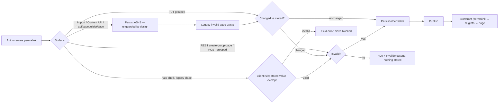
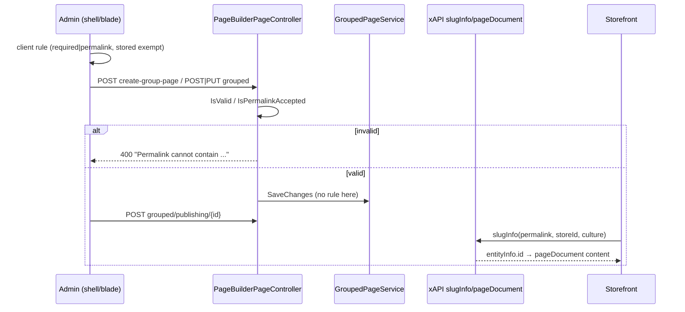
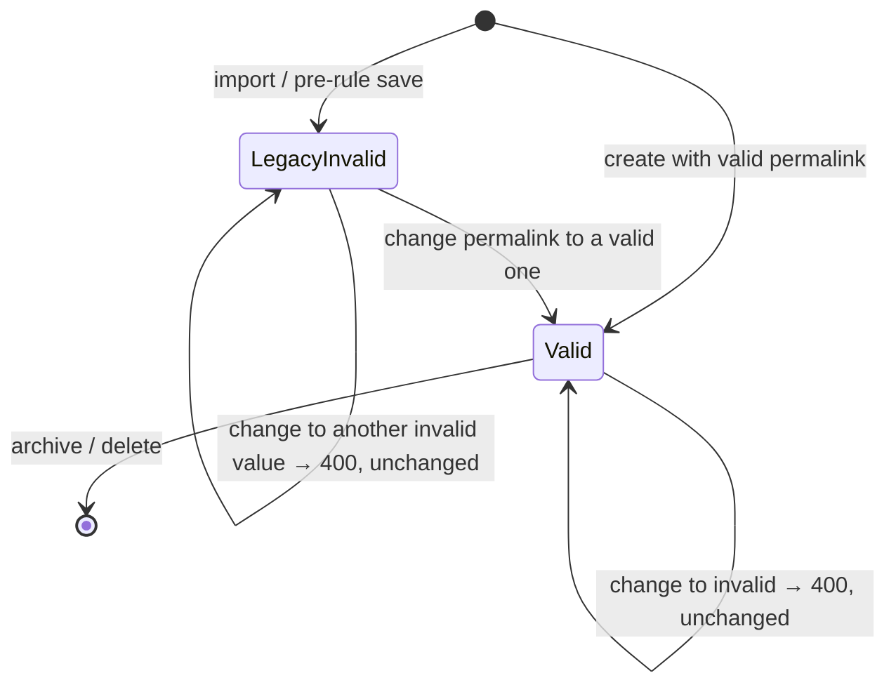

TEST MODEL — VCST-6443

Ticket:      VCST-6443 | Type: Task | Status role: fix-ready (Testing) | Flow: feature-test | Priority: P2 (Medium) | Path: FULL (cross-layer: api + admin-spa ×2) | Changed: Both (C# API + Vue shell + AngularJS blade)
Context:     FULL — 1c ba-system-analyzer (live probes on localhost, PR head e4ff) · 1d ba-story-writer (Mode B)
Prior model: none for this surface (reports/ba/test-models/VCST-4933-2026-09-17.md is Shared Components — no permalink chain; read, not carried)
Domain map:  .claude/knowledge/domain/page-builder.md @ rev 2 (generated 2026-09-23) — PRESENT
Mind map:    ABSENT (no page-builder.mind-map.json)
Env / build: localhost (start-local) · Platform 3.1089.0 · PageBuilderModule 3.1036.0-pr-178-e4ff (PR #178, confirmed by version) · Theme 2.60.0 · fresh DB, store B2B-store seeded at 3a
Chain position: touches domain links 2 (identity: Permalink entered + persisted), 7 (storefront resolves /<permalink> via slugInfo→pageDocument)
             and the publish step between them only as a carrier. Does NOT touch: Designer content authoring, Shared Components,
             scheduling, personalization (user groups/org), BuilderIO publishing (G3 collision stays OPEN), Git publishing flow.
Affected surface: vc-module-pagebuilder — Core/Models/PageBuilderPermalink.cs (IsValid) · Web/Controllers/Api/PageBuilderPageController.cs
             (CreateGroupPage, CreateGroup, UpdateGroup + IsPermalinkAccepted) · Apps/page-builder-shell PageDetails.vue + utilities/permalink.ts ·
             Scripts/blades/pages/edit-page.js/.tpl.html · ai/tools/create-page.yaml · 13+15 locales.
             Map MISSING (clause 11b, → domain_map.unmapped_surfaces[]): page-groups REST /api/page-builder-pages/*, legacy edit-page blade +
             its Content-module / api/pagebuilder/save write path, platform export/import of page groups, AI create-page tool.
Ticket signals: Decision comment (B. Kotov 2026-10-21) OVERRIDES the description: validate (400), never normalize. Rule: reject whitespace/control,
             ? # & \, `//`, `.`/`..` segments; allow any-language letters and `%`. PUT checks only a CHANGED permalink. UI error + Save blocked in
             shell AND legacy blade; stored legacy permalink never blocks other fields. Not applied to import / legacy migration.
             Autotests vc-test-automation-framework#208 pages.spec.ts (2 named) must pass. No attachments.
Epic context: none (no parent).
Domains:     page-builder (config domain `content-cms`); no BL-* family exists for CMS (domain map G7; bl:extract has no token)
Flows & boundaries: admin authoring ↔ REST group API ↔ GroupedPageService (unguarded) ↔ publish ↔ xAPI slugInfo/pageDocument ↔ storefront route
Risk areas:  VC-CMS-003 (rename/publish lifecycle loses content) · KB-2C75B17E (pre-fix: ?/# pages unreachable at natural URL) · KB-D245B911
             (slugInfo soft-404) · PARITY across 3 hand-copied rule implementations (C#, TS, JS) · auth-vs-validation ordering on create
AC traceability: 15 story ACs (AC-1..15, from the decision comment) + 26 gap-ACs → 32 atomic conditions C-01..C-32 (1d). Impl: SATISFIED statically
             for API ACs; NOT-FOUND (diff silent) for "blocks Save" in both UIs (AC-10/11) and the autotests (AC-15); DRIFT-suspect C-22 (400 before 403).
DoD:         none declared; 1d's implied DoD carried to 5-verdict (all "confirm at 5-verdict").

--- Part 0 — VALUE CHAIN ---
Value chain:
  L1 An author types a permalink for a page (REST call, Vue shell, legacy blade, AI tool — or an import file).
  L2 The system decides: the permalink is rejected (whitespace, control, ? # & \, //, ./..) or accepted; an UNCHANGED stored permalink is exempt.
  L3 Accepted → the page group stores the permalink exactly as typed (and mirrors it into content settings.permalink); rejected → NOTHING is stored.
  L4 The author is told: API answers 400 with the rule text; the UI shows the field error and will not Save.
  L5 The author publishes the page.
  L6 A shopper opens {{FRONT_URL}}/<permalink>; the storefront resolves it (slugInfo → pageDocument) and renders the page.
  L7 What it unlocks: every page that can be saved has a URL that opens as written; pages saved before the rule stay editable.

Chain diagrams:

Variants (union of the layers that BRANCH on the permalink):
  V1 REST create-group-page · V2 REST POST grouped · V3 REST PUT grouped, permalink changed · V4 REST PUT grouped, unchanged legacy-invalid ·
  V5 Vue shell, new/changed · V6 Vue shell, legacy-invalid page · V7 legacy blade, new/changed · V8 legacy blade, legacy-invalid page ·
  V9 import (unguarded by AC) · V10 AI create-page tool (description only) · V11 other write paths (Content API, api/pagebuilder/save, content-json)

Mechanism coverage matrix (columns = chain links, rows = variants; cells = scenario #):
| Var | L1 enter | L2 decide | L3 persist/none | L4 feedback | L5 publish | L6 storefront | L7 unlock |
|---|---|---|---|---|---|---|---|
| V1 | S2,S3 | S2,S3 | S2,S3 | S2,S14 | S11 | S11 | S11 |
| V2 | S4 | S4,S13 | S4 | S4 | WAIVED — same publish path as V1 | WAIVED — same | S4 |
| V3 | S5 | S5 | S5 | S5 | WAIVED — same as V1 | WAIVED — same | S5 |
| V4 | S6,S7 | S6,S7 | S6 | S7 | S6 | GAP — legacy ?/# page unreachable is pre-existing (KB-2C75B17E), out of scope | S6 |
| V5 | S1 | S1 | S1 | S1,S15 | S1 | S1 | S1 |
| V6 | S8 | S8 | S8 | S8 | S8 | WAIVED — as V4 | S8 |
| V7 | S9 | S9 | S9 | S9,S15 | WAIVED — blade publish = same API | WAIVED | S9 |
| V8 | S10 | S10 | S10 | S10 | WAIVED | WAIVED | S10 |
| V9 | S12 | S12 | S12 | WAIVED — no feedback by design | WAIVED | WAIVED | S12 |
| V10 | S16 | S16 | WAIVED — goes through V1 | WAIVED | WAIVED | WAIVED | S16 |
| V11 | S17 | S17 | S17 | WAIVED — no rule by design (PR body) | WAIVED | WAIVED | S17 |
Reverse edges: no money/points/stock move. Entitlement-like edge: a legacy-invalid permalink, once changed to valid, can never be restored
             (one-way) → covered by S8 (revert BEFORE save is allowed) — after save it is BY-DESIGN, not a finding. Clone of a legacy page
             (`permalink + "-copy"`, POST grouped) → S18.
Fixture lifecycle: a legacy-invalid page is terminal once its permalink is fixed (S6/S8/S10 mutate it) → each run seeds its OWN legacy page per
             scenario (via import or direct DB, 3a), never a shared one. Valid/invalid probe pages: AGENT-TEST-6443-* prefix, deleted in Cleanup.

--- Parts 1–5 — FAULT MODEL ---
Condition space:
  F1 surface: V1..V11 (11) · F2 operation: create / update-changed / update-unchanged (3) · F3 permalink class (12): valid-ascii, valid-unicode
  (/страница, /ページ), valid-% (/test%20page, /100%), allowed-edge (empty, no leading slash, trailing /, root /, U+200B, " < > { } | ^),
  ws-ascii (space lead/trail/inner, tab, LF), ws-unicode (NBSP, U+3000, U+0085, U+FEFF), control (U+0001), reserved (? # & \), empty-seg (//),
  dot-seg (., ..), look-alike full-width (？＃＆＼), case-only change · F4 stored state: fresh / legacy-invalid (2) · F5 caller: admin / no-Create
  permission (2) · F6 culture: en-US / other (2)
  Constraints: create × legacy-invalid infeasible; update-unchanged only with a stored page; V9–V11 have no rule (F3 collapses to one
  invalid representative). Raw N = 11 × 3 × 12 × 2 × 2 × 2 = 3 168.
Reduction: 3 168 → 18. (a) F3 exhaustively ONLY at V1 as one table-driven case per side (S2 reject, S3 accept) — the rule is one function
  (IsValid) called identically by V1–V3, so other REST variants take one invalid + one valid representative; (b) the 3 hand-copied client rules
  (TS, JS) get one representative per family + the stored-value exemption — the shared permalink-cases.json is already unit-tested for parity;
  (c) F6 culture DROPPED: no code path branches on culture in IsValid / IsPermalinkAccepted (diff-verified) — subsumed by S3's Unicode letters;
  (d) F5 only where validation runs BEFORE authorization (V1, V2) → S13; (e) look-alikes + U+200B fold into S3 (record actual = accepted).

Test scenarios (M = 18)
| # | Cell | Defect hypothesis | Archetype | Technique | Oracle | P |
|---|---|---|---|---|---|---|
| S1 | [JOURNEY] V5 shell: new page `/agent test 6443` → fix to valid → save → publish → storefront | Shell shows the error but Save still posts, or the corrected permalink saves yet the published page does not resolve at its URL | LIFECYCLE | FLOW | {SPEC} decision comment: error + Save blocked; valid page opens at /<permalink> | High |
| S2 | V1 × F3 every reject class (ticket STR first) | A class slips past IsValid (e.g. U+0085, leading space, `\`) and is stored; or nothing is said and 500 replaces 400 | BOUNDARY | EP | {SPEC} rule list → 400 + exact InvalidMessage, search finds no page | High |
| S3 | V1 × F3 accept classes + allowed-edge | Over-rejection: Unicode letters or `%` refused, or accepted value stored altered (trimmed/encoded) | BOUNDARY | EP | {SPEC} "letters of any language and % allowed"; stored verbatim. Allowed-edge rows are {OBSERVED} baseline — oracle needs an author decision (1d Q2) | High |
| S4 | V2 POST grouped invalid / valid | The 2nd create endpoint misses the rule (copy-paste gap) | PARITY | EP | {SPEC} POST grouped → 400 | High |
| S5 | V3 PUT changed → invalid, with another field changed in the same body | Partial save: other fields persist while the 400 is returned | SILENT | DT | {SPEC} 400 and stored state unchanged (GET before = after) | High |
| S6 | V4 PUT unchanged legacy-invalid + name change, then publish | Exemption missing: legacy page cannot be edited/published any more | LIFECYCLE | ST | {SPEC} "PUT checks only when it changes" → 200, permalink untouched, publish OK | High |
| S7 | V4 PUT legacy-invalid changed only in case / to another invalid | Exemption over-broad: any edit of a legacy page bypasses the rule | BOUNDARY | ST | {SPEC} changed → validated → 400 | Medium |
| S8 | V6 shell: open legacy page, edit name → Save; edit permalink invalid → blocked; revert → Save | Shell compares against the edited value or loses storedPermalink after a save → legacy page un-saveable | LIFECYCLE | ST | {SPEC} "stored permalink does not block saving other fields" | High |
| S9 | V7 legacy blade: new/changed invalid permalink | Blade error shown but Save button enabled (ui-validate not wired to form $invalid) | PARITY | EP | {SPEC} "error and blocks Save … legacy AngularJS blade" | High |
| S10 | V8 legacy blade: legacy page, other field → Save; after one in-session save | origEntity not refreshed → second save blocked | LIFECYCLE | ST | {SPEC} same as S8 | Medium |
| S11 | V1 accepted /страница and /test%20page → publish → storefront | Rule allows a permalink the storefront cannot open (decode mismatch in slugInfo) — the ticket's own impact re-created | PARITY | FLOW | {SPEC} ticket impact: "page URL must open as written"; {HYPOTHESIS} for % — decision says allowed, nothing says it opens | High |
| S12 | V9 import page group with `/legacy page` | Rule leaks into import → whole import fails (ECL-6.4 partial-import) | CONFIG | EG | {SPEC} "Not applied to platform import" → import succeeds, value verbatim | Medium |
| S13 | V1/V2 caller without Create permission + invalid permalink | 400 leaks validation before authorization (should be 403) | SCOPE | DT | {HYPOTHESIS} platform convention authz-before-validation; real oracle = author answer (1d Q2) | Medium |
| S14 | V1 400 response contract (status, content-type, body) | Body shape undocumented/unstable for integrations (string vs ProblemDetails) | FALLBACK | EG | {SPEC} PR "Behavior change": 400 with the message; shape {OBSERVED} until author confirms | Low |
| S15 | V5/V7 message in ru + ja UI locale | Locale key missing → raw key shown in one of the two apps | RENDER | EP | {SPEC} PR: messages in all locales of both admin UIs | Low |
| S16 | V10 AI create-page tool description | Description not shipped in the deployed module | SILENT | EG | {SPEC} AC-13 | Low |
| S17 | V11 Content API / api/pagebuilder/save with invalid settings.permalink | Bypass stores an invalid permalink the group API refuses | PARITY | EG | {SPEC} PR body: client-only by design → record, not fail | Low |
| S18 | Clone (UI) of a legacy-invalid page | Clone builds `<legacy>-copy` and POST grouped now 400s → clone silently broken for legacy pages | LIFECYCLE | EG | {HYPOTHESIS} clone is a create; oracle = author decision | Medium |
Plus: autotests vc-test-automation-framework#208 pages.spec.ts (AC-15) — executed at 4a as evidence for AC-15, not a scenario row.

Probes carried in: VC-CMS-003 → S6 (publish after legacy edit) + S1 (save→publish→open) · VC-CMS-001/002 → N/A (search suggestions / designer blocks, not touched)
Archetype sweep: BOUNDARY S2,S3,S7 · PARITY S4,S9,S11,S17 · SILENT S5,S16 · LIFECYCLE S1,S6,S8,S10,S18 · SCOPE S13 · CONFIG S12 · FALLBACK S14 ·
  RENDER S15 · STALE WAIVED — no cache between save and validation (rule is synchronous) · RACE WAIVED — no read-then-write invariant ·
  REPLAY WAIVED — validation is idempotent · MONEY WAIVED — no currency; culture dropped in Reduction (c)
UIP sweep (UI only): UIP-INPUT S1,S8,S9 (paste/whitespace) · UIP-REFRESH S8 (reload after save keeps exemption) · UIP-BACK/DEEP/TABS/EXPIRE/
  STORAGE/NET/VIEW/DATA WAIVED — admin form validation only, no navigation/session/storage/viewport behaviour changed by the diff
Business Rules: none exist for CMS (G7). Proposed BL-CMS candidate from the decision comment — routed to /qa-review-oracles, not minted here.
Edge cases:  ECL-7.2 (special characters — rejected, not truncated) · ECL-6.4 (import: rule must not abort an import) · ECL-12.1 row 2 (UI locale)
Docs grounding: VirtoOZ not yet queried for permalink rules; domain map G5 (11 doc quotes) holds none → NEW behaviour: {SPEC} = decision comment.
Observed grounding: KB-2C75B17E (pre-fix stored verbatim, ?/# unreachable) · KB-D245B911 · KB-2E8CAC3D.
Agents to dispatch: 3x /qa-exploratory (playwright-firefox) · 4a qa-backend-expert (playwright-edge: REST + both admin UIs + storefront S11) ·
  4v ui-ux-expert WAIVED — visual_surface: only an inline field error text is added; recorded at 2c · A test-management-specialist (2a + author)

Unresolved → 3x charter: S3 allowed-edge oracle · S11 (% / Unicode resolution) · S13 ordering · S18 clone · C-30 content-json bypass ·
  AC-10/11 "blocks Save" (NOT-FOUND in diff) · whether Publish is also blocked in both UIs.
FIXTURE-GAP: legacy-invalid page group (per scenario: S6, S7, S8, S10, S18) — seed via platform import (preferred) or direct DB update (3a).

## Round 1 — amendments from 3x discovery (2026-10-22, SBTM-VCST-6443-2026-10-22.md)
- S11 SPLIT → S11a Unicode `/…-страница` (OBSERVED renders: browser encodes, storefront decodes, slugInfo matches raw) · S11b `%20` permalink
  (OBSERVED 404 at natural URL: storefront decodes before GetSlugInfo → null; reachable only as %2520) — candidate defect, oracle {SPEC} ticket
  impact "URL opens as written" + decision "% allowed". Storefront preconditions added: store `VirtoPages.Enable=true`, Pages index built,
  page `visibility:true` (create-group-page without it stores false → anonymous 404).
- S13 → OBSERVED 403 before validation for a user lacking Create (method-level [Authorize(Create)]). Residual cell "has Create, wrong store"
  → GAP (no fixture; not a ticket AC) — WAIVED for this run.
- S18 → OBSERVED 400 + blade alert + toast, no page created; + variant S18b: Clone with an unsaved invalid permalink in the form → same 400.
- AC-10/AC-11 → OBSERVED: shell Save disabled (also when another field is dirty), Publish disabled while dirty; blade Create disabled (new) /
  Save + Publish disabled (existing). Legacy blade = Content → store → Pages (`.page` files), not page groups.
- V11/S17 → content-json with invalid settings.permalink → 204; group permalink stays valid, draft + published content carry the invalid
  value; pageDocuments lists the group permalink. New L6 question S17b: which value does the storefront render/SEO use. Oracle {HYPOTHESIS}.
- RE-BASE: CMS-089 (060b line 38) expects "sanitize or reject … sanitized permalinks accessible" — conflicts with decision "never normalize".
- NOTE (copy): UI text "spaces" vs server "whitespace, control characters" — not an AC.
Matrix delta: V1×L6 S11a/S11b · V11×L6 S17b · V2×L2 S13 (OBSERVED) — no blank cell introduced.

## Round 1 — 2a disposition (Artifact A phase 2a, 2026-10-22)
Command: `npm run tc:scope -- --domain content-cms --module page-builder --observable permalink --observable create-group-page --observable "page-builder-pages/grouped" --json` · 17 suites scoped, 615 rows scanned, 70 hits (all WILL_RUN; FILTERED_OUT not computable at wave B) · 70 never audited.
Unscannable (legacy 11-column header, permalink exposure UNKNOWN, not clean): 062, 069. Unmatched observable: `create-group-page` (corpus gap, authored as CMS-221, CMS-233). Mind map absent.
Result: 69 CONFIRMED · 1 RE-BASE (CMS-089, 060b: expects "sanitize or reject … sanitized permalinks accessible", contradicts decision "never normalize"; assertion kept, carried into C1) · 0 REPAIR · 0 SUPERSEDED.
CONFIRMED (valid or absent permalink data, no create/update with a now-invalid value):
- 050f: CMS-GQL-014, 115, 123, 124, 125, 126, 130, 131, 132
- 059: CMS-001, 002, 017, 053, 099, 111, 113, 115, 116, 118, 119, 120, 121, 122, 124, 126, 129, 130, 135
- 060: CMS-014, 016, 030, 059, 074, 078, 079, 080, 081, 082, 083
- 060b: CMS-084, 085, 086, 087, 088, 093, 094, 095, 110, 149, 150, 151, 152, 153, 157, 169, 170, 171, 172, 173
- 060c: CMS-175, 199, 200, 207, 208, 209, 210, 211, 212, 215
Out-of-scope notes: CMS-094 calls a stale path `/api/page-builder/grouped-pages` (independent of this ticket); `PB_6443_LEGACY_S10` is unused by any row (the legacy blade edits Content `.page` files, not page groups).
New Draft rows: 059 CMS-220..CMS-242. C1 set = CMS-220..CMS-242 (059) + CMS-089 (060b).
