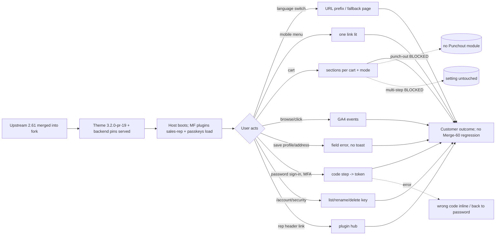
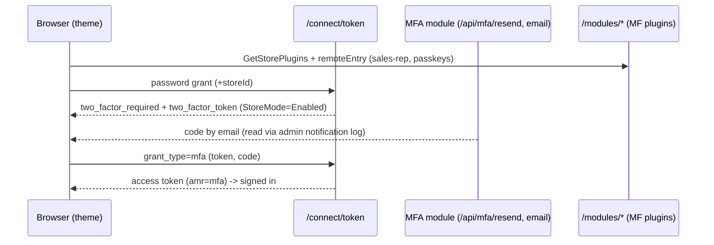
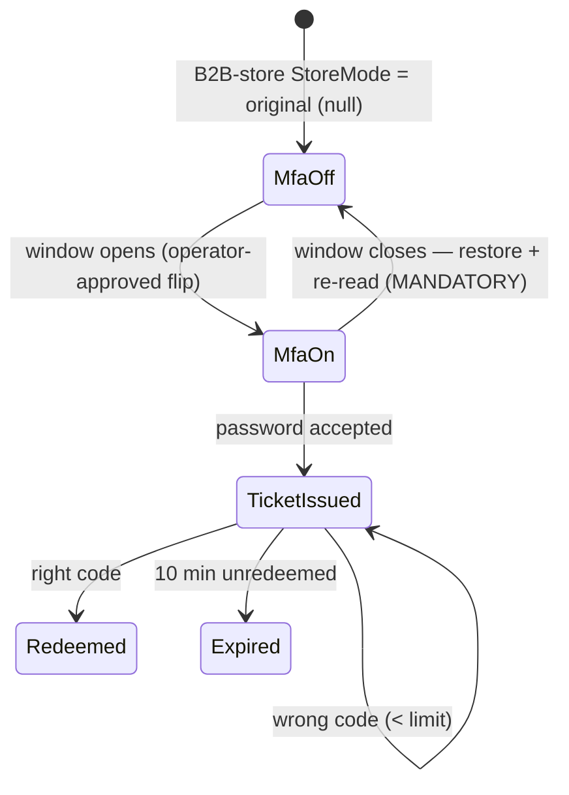

# TEST MODEL — VCST-6626

Ticket: VCST-6626 "Merge 61 Release to Next" | Type: Task | Status role: testable | Flow: feature-test | Priority: P1 (High) | Path: FULL | Changed: Frontend (fork theme) + backend pins
Shape class: feature (ui-kit = 30/498 files; the surface under test is the merged features, not the kit)
Build: vc-frontend-next PR #19 @ 4507f3ae, live bundle `3.2.0-pr-19-4507-4507f3ae` (index chunk, last-modified 2026-11-02 12:31Z) · vcptcore-qa, platform 3.1091.0-pr-3144 · deployed by vc-deploy-dev@vcptcore-qa 2026-11-02 12:28Z (theme + backend per the PR's backend-packages.json)
Context: FULL — 1c ba-system-analyzer, 1d ba-story-writer (Mode B), 1r qa-frontend-expert (REACHABLE, data gaps)
Prior model: none in repo for Next merges (VCST-6398 Merge 60 left no model file; its run folder reports/tickets/Sprint26-21/VCST-6398/ is the predecessor record — Part 0 below re-derived, not carried)
Domain map: auth.md @ rev 3 (2026-10-28) PRESENT · mobile-navigation.md @ rev 1 (2026-09-09) PRESENT · sales-rep.md (2026-09-18) PRESENT, §3 in-theme hub STALE after this merge · punchout.md (2026-10-27) PRESENT · ABSENT: i18n/locale switch, GA4, cart/checkout sections, account profile/addresses
Mind map: auth.mind-map.json — auth.signin.mfa.*, auth.state.mfa-ticket.*, auth.signin-methods.*, auth.signin.method-choice.passkey-button · sales-rep.mind-map.json — sr.hub.*, sr.store-toggle.on-shows-hub
Contract: REFRESHED — {RUN_DIR}/knowledge/api/graphql-schema.md @ 2026-11-02 (128 Q / 157 M); fixtures 86/86
Chain position: merge chain L1–L6 below. Per domain: auth L(sign-in password → MFA code → token) and signin-methods (manage keys) — touched; auth OTP/password-reset/lockout — NOT touched except OTP code-form refactor (regression only). punchout L5–L10 touched in code but unreachable (module absent), L1–L4, L11–L12 not touched. sales-rep: only hub delivery (host→plugin) touched; customers/orders/dashboard data links NOT touched. mobile-navigation: highlight rule only; drawer structure/breakpoint NOT touched. Unmapped (no map): locale switch, GA4, cart sections, profile field errors.
Affected surface: vc-frontend-next client-app — shared/layout/composables/useLocaleSwitch.ts, virto-pages.vue, alternate-links.ts; mobile-menu-link.vue, account-navigation-item.vue, core/utilities/menu; pages/cart.vue, shared/checkout/composables/useCheckoutSections.ts, modules/punchout/**; shared/catalog/components/category.vue, modules/google-analytics/{events,index,pending-login,user-properties}.ts, useSavedForLaterAnalytics.ts, compare-table.vue; useFieldErrors.ts, pages/account/{profile,addresses}.vue; sign-in-form.vue, mfa-verify-form.vue, useMfaSignIn.ts, sign-in-code-form.vue, useAuth.ts; pages/account/security.vue, useSignInMethods.ts, config/menu.json; modules/sales-rep/** (deleted), app-runner.ts, settings_data.json; ui-kit/utilities/quantity-stepper.ts, copy-and-paste.vue, quotes pages, error-handler.ts/broadcast.ts. Unmapped surfaces → domain_map.unmapped_surfaces[] (1c §4, 9 items).
Ticket signals: dev comment 2026-10-30 (Ivan Kalachikov) = the 8-area checklist + "Not covered by the smoke" lines (one-language page, signed-in account links, punch-out, multi-step, saved-for-later, compare); "view_item twice after a category click — check against dev". No attachments. Merge log upstream-merges/2026-10-29-2.61.0.md: cart.vue section conditions and @select-item handlers have NO unit test; fork restyle of the in-repo hub deleted by PO decision (not a defect). PR CI green, deploy-cloud skipped, CLA pending.
Epic context: none (no parent). Clone of VCST-6398 (Merge 60, Done, PASS WITH NOTES on vcst; open VCST-6452/6453/6454).
Domains: auth, cart, chk, ga4, profile, punchout, sr, seo/i18n, ui, a11y
Flows & boundaries: host ↔ MF plugins (sales-rep, passkeys) · locale switch ↔ pages module/GetSlugInfo · cart ↔ checkout extension points ↔ punchout · storefront ↔ /connect/token mfa grant ↔ /api/mfa/resend · theme ↔ GA4 dataLayer
Risk areas: VC-AUTH-004/006, VC-CHECKOUT-002, VC-ANALYTICS-001, VC-UI-007, VC-SEARCH-004; VCST-6452/6453/6454; KB-912B0774 (Back after switch 404, suspected); KB-1A452441 (Security icon names, suspected)
AC traceability: 27 atomic ACs (AC-1…AC-27, 1d) + gap-ACs GAP-1…GAP-31 → 41 conditions T-01…T-41. Impl verdicts: DRIFT AC-6 (activeWhen from plugin), AC-9/10 (punch-out: requisition button, no order message), AC-23/24/25 (plugin contribution; no refetch; modal closes on failure); CONTRADICTS AC-11 with punch-out; NOT-FOUND AC-16 (no view_item change), AC-26 (hub is plugin).
DoD: none declared — 1d's proposed minimal DoD carried to 5-verdict (build named, every area resolved, view_item A/B, console/network clean, uncovered-change checks, pre-release pins recorded).
Operator decisions (2026-11-02): MFA → enable B2B-store StoreMode for a dedicated window, then restore + re-read. Multi-step checkout → REVISED by operator: single-page first (S10–S12), THEN a multi-step window (flip checkout_multistep_enabled, S14, restore + re-read). Punch-out → BLOCKED (VirtoCommerce.Punchout absent; no createPunchoutRequisition in schema). Windows are sequenced: all non-window areas → multi-step window → MFA window; never overlapping.

## Part 0 — VALUE CHAIN

Value chain:
- L1 Upstream 2.61.0 fixes land in the fork (merge resolution keeps fork look, takes upstream rules).
- L2 The merged theme + pinned backend are what the stand serves (bundle version, modules, MF plugins listed).
- L3 The host boots and composes its surfaces: menus/routes from config, sales-rep + passkeys contributions from Module Federation.
- L4 A shopper/rep/member acts on a merged surface: switches language, opens a menu, fills a cart, signs in, edits profile, manages keys, opens the hub.
- L5 The effect is persisted or emitted: URL/locale + slug resolution, cart section state, contact/address saved or rejected per field, token issued after the 2nd factor, key renamed/deleted, GA4 events pushed.
- L6 What it unlocks: buying in their language, finishing checkout, a protected account, trustworthy analytics, a working rep hub — with nothing that worked in Merge 60 lost.

Variants (union of the layers that branch): areas A1…A8 + merged-but-unlisted changes X1 quantity-stepper max===0, X2 error-handler single toast, X3 GA4 login/user_properties, X4 hreflang alternates, X5 bulk-order paste parser, X6 OTP code-form refactor, X7 quotes i18n (VCST-6452), X8 a11y fixes (VCST-6454, barcode label), X9 ui-kit in Storybook (15 kit components changed, new VcTileButton/VcStatWidget, kit locales ×13); roles anonymous · buyer · corporate member · sales rep · MFA buyer; viewport desktop 1920 · mobile 375.

Mechanism coverage matrix (columns = links; rows = variants):
| Variant | L2 served | L3 compose/entry | L4 action | L5 effect | Error/negative | Mobile | No-regression |
|---|---|---|---|---|---|---|---|
| A1 locale | S1 | S2 | S2,S3,S4,S50 | S2,S3 | S6 | S5 | S7 |
| A2 menu highlight | S1 | S9 | S8,S9 | S8 | WAIVED: no error path (pure render) | S8,S9 | S9 |
| A3 cart sections | S1 | S10 | S10,S11,S14 | S12,S14 | S13 (punch-out BLOCKED) | GAP: mobile cart not in AC — covered only by S1 at 1920 | S10 |
| A4 GA4 | S1 | S15 | S15–S19,S22 | S15–S20 | S17 | WAIVED: events viewport-independent | S20 (A/B) |
| A5 field errors | S1 | S23 | S23,S25 | S23,S25 | S24 | WAIVED: same form component | S24 |
| A6 MFA | S1 | S26 | S26,S28 | S28 | S27,S29 | WAIVED: one form, desktop only | S30 |
| A7 Security | S1 | S32 | S34,S35 | S34,S35 | S35,S36 | S32 | S37 |
| A8 Sales Rep hub | S1 | S38 | S38 | S38 | S39 | GAP: plugin mobile hub not in AC | S40 |
| X1 quantity | S1 | WAIVED: no distinct entry/served step for this variant (in-page change; S1 proves served build) | S41 | S41 | S41 | WAIVED | S41 |
| X2 toast | S1 | WAIVED: no distinct entry/served step for this variant (in-page change; S1 proves served build) | S45 | S45 | S24,S45 | WAIVED | S45 |
| X3 GA4 login | S1 | WAIVED: no distinct entry/served step for this variant (in-page change; S1 proves served build) | S21 | S21 | S21 | WAIVED | S21 |
| X4 hreflang | S1 | WAIVED: no distinct entry/served step for this variant (in-page change; S1 proves served build) | S7 | S7 | S7 | WAIVED | S7 |
| X5 bulk paste | S1 | WAIVED: no distinct entry/served step for this variant (in-page change; S1 proves served build) | S42 | S42 | S42 | WAIVED | S42 |
| X6 OTP refactor | S1 | S31 | S31 | S31 | S31 | WAIVED: one form | S31 |
| X7 quotes i18n | S1 | WAIVED: no distinct entry/served step for this variant (in-page change; S1 proves served build) | S43 | S43 | WAIVED | WAIVED | S43 |
| X8 a11y | S1 | WAIVED: no distinct entry/served step for this variant (in-page change; S1 proves served build) | S44,S37 | S44 | WAIVED | WAIVED | S44 |
| X9 ui-kit Storybook | S47 | S47 | S48 | S48 | S48 | S48 | S49 |
| S50 | A1 PDP whose de translation has its own slug (Affligem Dubbel 24x30cl Bottle, de `…-bottle-de`): switch en → de | slug resolved without the culture → the de URL keeps the en slug and renders a DIFFERENT product (3x saw '30L Keg') | PARITY | EP | {SPEC} AC-1 "the page shows" (same entity) | Critical |
| Role: anonymous | S1 | S36 | S36 | WAIVED: no distinct entry/served step for this variant (in-page change; S1 proves served build) | S36 | WAIVED | S36 |
| Role: corporate member | WAIVED: no distinct entry/served step for this variant (in-page change; S1 proves served build) | S8 | S8 | S8 | S46 | S8 | S8 |
| Role: sales rep | WAIVED: no distinct entry/served step for this variant (in-page change; S1 proves served build) | S38 | S38 | S38 | S39 | GAP | S40 |
| Role: MFA buyer | WAIVED: no distinct entry/served step for this variant (in-page change; S1 proves served build) | S26 | S26–S29 | S28 | S27 | WAIVED | S30 |

Reverse edges:
- MFA store setting flipped ON → restored to original + re-read: covered by S30 (mandatory; an unrestored flag breaks every B2B-store sign-in).
- Multi-step flag flipped ON → restored to original + re-read: S14 (mandatory; checkout of every stand user changes while it is on).
- Passkey created for the test → deleted: S35 (delete is the reverse; cancel keeps it).
- Profile last name rejected → contact unchanged: S23 (re-read after reload). Address created in-case → deleted in Cleanup: S25.
- Saved-for-later move → move back to cart: S18 Cleanup. Cart lines added → removed: S10/S11 Cleanup.
- Punch-out requisition (session → Returned, at most once, BL-PUNCHOUT-003): ABSENT ON STAND — not reachable, recorded in S13.
- Language pinned → switching back to default drops the prefix: S2.

Fixture lifecycle: MFA two-factor ticket is single-use and expires in ~10 min (auth.state.mfa-ticket.*) — each MFA scenario requests its own. A passkey is per-run (virtual authenticator dies with the context) — create in the case (FIFTH RULE). Saved-for-later and cart state are per-account mutable — create in case, clean up.

## Part 0r — ROLE SCENARIOS

Roles in scope:
- anonymous → no fixture
- buyer → USER_EMAIL / USER_PASSWORD (1r: signs in on B2B-store)
- corporate member with /company/activities → FIXTURE-GAP (ORG_USER 400 store-gated; MULTI_ORG blank pages) → routed to 3a
- sales rep with ≥1 customer → FIXTURE-GAP (SR logins 400 with SR_REP_PASSWORD) → routed to 3a
- MFA buyer (confirmed email) → FIXTURE-GAP → 3a, used only inside the MFA window

BSC-1 — A buyer reads the store in German and comes back
  Role: buyer · Situation: browses a product, switches to Deutsch, then to English
  | 1 | Switch to de on a PDP | URL /de/<slug>, page renders | browse | prefix present |
  | 2 | Switch back to en-US | same page, no prefix | browse | no prefix, no 404 |
  Outcome: the shopper keeps the page in any language. Not allowed: a 404 or the home page instead of the product.

BSC-2 — A corporate member checks their colleagues' activity on a phone
  Role: corporate member · Situation: /company/activities?organizationId=… at 375 px
  | 1 | Open mobile menu | account links | navigate | "My customers' activity" lit (text + icon), "My activity" not |
  Outcome: the member knows where they are. Not allowed: two lit links; the activity page for an org they do not belong to (server refuses with their token).

BSC-3 — A protected buyer signs in with a second factor
  Role: MFA buyer · Situation: B2B-store StoreMode=Enabled window
  | 1 | Password sign-in | code step with header | enter code | no token yet |
  | 2 | Wrong code | inline error, stays on step | retry | not signed in |
  | 3 | Right code | signed in | shop | token issued |
  Outcome: account protected. Not allowed: a token on the password step alone (server returns two_factor_required, no access_token).

BSC-4 — A buyer manages their passkeys
  Role: buyer · Situation: /account/security with one passkey created in-case
  | 1 | Rename key | new name in list | — | list shows new name without reload |
  | 2 | Delete key (confirm) | key gone | — | empty state |
  Outcome: the buyer controls their sign-in methods. Not allowed: an anonymous visit (redirect to /sign-in?returnUrl=/account/security); renaming another user's key (server refuses).

BSC-5 — A sales rep opens their hub
  Role: sales rep · Situation: header link after sign-in
  | 1 | Open hub | dashboard + My customers from the plugin | work | plugin chunks served from /modules/ |
  Outcome: rep keeps working after the built-in hub is deleted. Not allowed: a buyer seeing the hub link or reaching rep routes (redirect to /account/dashboard; salesRep* queries refused for the buyer token).

## Parts 1–5 — FAULT MODEL

Condition space: area {A1…A8, X1…X9}=17 · role {anon, buyer, member, rep, MFA}=5 · viewport {1920, 375}=2 · language {default, non-default with translation, non-default without}=3 · cart {physical, digital-only, mixed}=3 · checkout mode {single-page, multi-step, punch-out}=3 · MFA {off, on}=2 · passkey {none, ≥1}=2. Constraints: punch-out infeasible (module absent); multi-step only inside its window, after single-page; MFA on only inside its window; passkey only for signed-in roles; rep/member only with fixtures. Raw N = 17×5×2×3×3×3×2×2 = 18 360.
Reduction: N → M = 50. Area-independence: each area's code path reads only its own factors, so factors are crossed only within the area that branches on them (language ↔ A1/X4; cart ↔ A3; MFA ↔ A6; passkey ↔ A7; role ↔ A2/A6/A7/A8). Viewport kept only where an AC names mobile (A1, A2, A7). Dropped: checkout mode punch-out (BLOCKED, S13 records it), multi-step × cart composition (S14 runs physical cart only — useCheckoutSections hides every section regardless of composition when multi-step is on); language × all non-A1 areas (subsumed by S1 crossing de once); OTP (X6) off on every store — subsumed by S26 exercising the shared code form.

Test scenarios (M = 50)
| # | Cell | Defect hypothesis | Archetype | Technique | Oracle | P |
|---|---|---|---|---|---|---|
| S1 | buyer, 1920, de once: sign in → category → PDP → cart → security → sign out | a hand-resolved merge conflict (cart.vue, useLocaleSwitch) breaks the end-to-end journey although each unit test passes | PARITY | FLOW | {SPEC} dev checklist; footer = 3.2.0-pr-19-4507 | Critical |
| S2 | A1 buyer desktop PDP+category en→de→en | prefix not added/removed because getSlugInfo still receives the locale-prefixed permalink (#2576) | FALLBACK | ST | {SPEC} AC-1/2 | High |
| S3 | A1 one-language page /bkp-test01 (de-only) from en | fallback not stored → 404 instead of the page | FALLBACK | EP | {SPEC} AC-3; {OBSERVED} KB-2BA242BB → SPEC once dev confirms CMS pages behave like products | High |
| S4 | A1 third-language hop (de-only page: en-GB→en-US, fr) | previousCultureSlug lost on second hop → 404 (#2604) | STALE | ST | {SPEC} AC-4 | High |
| S5 | A1 mobile 375 selector, S2+S3 | mobile wrapper not wired to useLocaleSwitch after fork's header-menu split | PARITY | EP | {SPEC} AC-5 | Medium |
| S6 | A1 browser Back after switch to default | /<locale>/ previous URL renders 404 | STALE | EG | {HYPOTHESIS} KB-912B0774 — oracle becomes {SPEC} if dev confirms Back must restore the page | Medium |
| S7 | X4 hreflang on 2-language page vs absent on 1-language | alternates built from visited host or emitted for unpublished cultures | RENDER | EP | {BL-SEO-003} neighbour; {SPEC} #2576 PR body | Low |
| S8 | A2 corporate member 375 /company/activities | plugin link lacks activeWhen → "My activity" lit instead | PARITY | DT | {SPEC} AC-6 (fail attributed to SalesRep plugin, not merge) | Medium |
| S9 | A2 anon/buyer /compare 375 | icon and text disagree after fork-modifier + upstream-rule merge | RENDER | EP | {SPEC} AC-7 | Medium |
| S10 | A3 buyer physical cart single-page | hand-merged cart.vue drops a section or the fork spacing class | RENDER | EP | {SPEC} AC-8; {BL-CHK-001} | High |
| S11 | A3 digital-only cart | Shipping still shown (allItemsAreDigital not wired) | RENDER | DT | {SPEC} AC-8/T-09 | High |
| S12 | A3 mixed/physical incomplete payment | warning counts hidden sections → blocks or misleads | STALE | DT | {SPEC} #2564; {BL-CHK-002} | Medium |
| S13 | A3 punch-out session | positive BLOCKED (no module); negative: a regular user wrongly gets Create requisition or loses Place order | SCOPE | EP | {BL-PUNCHOUT-008} negative half; positive BLOCKED | Medium |
| S14 | A3 multi-step window (after S10–S12): flip checkout_multistep_enabled on → cart shows no checkout sections, ProceedTo leads to /checkout steps, an order step renders; restore + re-read | isSinglePageCheckout ignores the flag after the hand-merge → sections still render or the button goes nowhere (VC-CHECKOUT-002 / VCST-5369 Place-Order-with-multistep history) | RENDER | ST | {SPEC} AC-11 | High |
| S15 | A4 category page 1 → infinite scroll page 2 | page-2 view_item_list repeats page-1 items (VCST-6453 retest) | REPLAY | ST | {BL-GA4-001}; {SPEC} AC-12 | High |
| S16 | A4 select_item on a page-2 product | index/list id from wrong page | SILENT | BVA (first/last of page) | {SPEC} AC-13 | Medium |
| S17 | A4 sort change then click | stale reportedPositions → old page/index | STALE | ST | {SPEC} T-19 | Medium |
| S18 | A4 buyer saved-for-later click + impression | list id still recently_browsed_products; no index | SILENT | EP | {SPEC} AC-14, GAP-16 | Medium |
| S19 | A4 compare 3 products, click column 3 | index = 0 or product order not column order | SILENT | BVA | {SPEC} AC-15 | Medium |
| S20 | A4 PDP from category click: count view_item, Next vs dev control | view_item fires twice (dev saw it) | REPLAY | A/B control | {SPEC} AC-16 "once per visit"; pre-existing if dev also 2 | Medium |
| S21 | X3 login: one event per attempt, success sent from landing page; user_properties set | login lost or doubled by the deferral; user props stale after sign-out | RACE | ST | {BL-GA4-004} (possibly stale); {SPEC} module README | Medium |
| S22 | A4 search dropdown + wishlist select_item index | index missing on secondary surfaces | SILENT | EP | {SPEC} GAP-15 | Low |
| S23 | A5 profile last name "Tester2" | toast instead of field message, or no message (backend #150 absent) | SILENT | EP | {SPEC} AC-17 (#2597 body) | High |
| S24 | A5 rejected + valid field, edit rejected field; non-field error | message clears wrong field; non-field error swallowed | SILENT | DT | {SPEC} GAP-9 | Medium |
| S25 | A5 address modal add with invalid value | modal closes / toast / no field message | SILENT | EP | {SPEC} AC-18 | Medium |
| S26 | A6 MFA buyer password on /sign-in and static login section | code step absent on the static-page host (fork renders via login-form-section) | PARITY | EP | {SPEC} AC-19; mind auth.signin.mfa.required-challenge | Critical |
| S27 | A6 wrong code | error not shown / form leaves code step | SILENT | EP | {SPEC} AC-20; auth.signin.mfa.wrong-code-limit | High |
| S28 | A6 right code (email via notification log) | grant_type=mfa not sent with token → stuck | SILENT | FLOW | {SPEC} AC-21; auth.signin.mfa.verify-code | Critical |
| S29 | A6 resend within cooldown / after; Back | resend error banner or no new code; Back loses email | RACE | ST | {SPEC} GAP-6; auth.signin.mfa.resend | Medium |
| S30 | A6 window closed: restore StoreMode, re-read, buyer signs in in one step | flag left on → every B2B-store user challenged | CONFIG | ST | {SPEC} operator decision; auth.signin.mfa.off | Critical |
| S31 | X6 OTP email sign-in on B2B-store (OTP is ON — 3x M8): request, wrong code, right code (code from the notification journal) | the refactored sign-in-code-form breaks OTP: no error on a wrong code, or the code never submits | SILENT | EP | {SPEC} T-41; mind auth.signin.otp.happy / wrong-code | High |
| S32 | A7 Security link in rail + mobile menu; page opens | menu.json entry missing in one menu | RENDER | EP | {SPEC} AC-22 | High |
| S33 | A7 page lists Passkey method (authTypes Password, GoogleSSO, Passkey) | contribution not registered → blank page | RENDER | EP | {SPEC} AC-23 | High |
| S34 | A7 add passkey (virtual authenticator, chrome/edge) → rename | list not refetched → old name until reload | STALE | ST | {SPEC} AC-24 (rename "works") | High |
| S35 | A7 delete: cancel keeps, confirm removes | modal closes on failure; list stale | STALE | DT | {SPEC} AC-25 | High |
| S36 | A7 anonymous /account/security | page leaks or redirect without returnUrl | SCOPE | EP | {BL-AUTH-*} guard; {SPEC} route meta | Medium |
| S37 | A7 icon buttons accessible names, modal focus | buttons named "Edit"/"Delete" without key name | RENDER | EG | {BL-A11Y-002}; KB-1A452441 | Low |
| S38 | A8 rep header → hub dashboard + My customers | hub dead after built-in deletion; chunks from /assets | LIFECYCLE | FLOW | {SPEC} AC-26/27; sr.store-toggle.on-shows-hub | Critical |
| S39 | A8 buyer: no hub link; direct /company/dashboard redirects | dead link or rep route reachable | SCOPE | EP | {BL-SR-011}; sr.hub.non-rep-direct-url | High |
| S40 | A8 boot: one GetStorePlugins, no blocking | plugin list fetched twice / boot waits | RACE | EG | {SPEC} Merge-60 control | Medium |
| S41 | X1 product without max quantity: change cart line qty | max===0 now = real max 0 → stepper blocks | BOUNDARY | BVA | {BL-CART-001}; ECL-5.3 | High |
| S42 | X5 bulk order paste: spaces, newlines, trailing comma, 10-digit qty | valid lines rejected / invalid accepted | BOUNDARY | BVA | {SPEC} copy-and-paste tests in PR | Medium |
| S43 | X7 quotes pages after hard reload | raw i18n keys (VCST-6452 retest) | RENDER | EG | {SPEC} VCST-6452 | Medium |
| S44 | X8 configurable "none" radio + barcode input names | still unnamed (VCST-6454 retest) | RENDER | EG | {BL-A11Y-002} | Low |
| S45 | X2 GraphQL error with 2 errors on a non-form action | two toasts / none / Report-a-problem on field errors | SILENT | EG | {SPEC} #2597 error-handler | Medium |
| S46 | corporate member MULTI_ORG signs in → blank pages | ApolloError resolving contact firstName/lastName breaks the app shell | RENDER | EG | {OBSERVED} 1r → {SPEC} if an incomplete contact must still render | High |
| S47 | X9 Storybook {STORYBOOK_URL}: served build is Next PR #19 (version/fork marker), index lists VcTileButton + VcStatWidget | Storybook on the stand is upstream vc-frontend or a stale build, so the kit under test is not the merged one | CONFIG | EP | {SPEC} storybook-ci.yml PR deploy; last-modified 2026-11-02 12:42Z | High |
| S48 | X9 new VcTileButton / VcStatWidget stories: states, light+dark, 375/768/1920, keyboard, axe | new kit components ship with contrast/name/focus defects nobody sees because no page uses them yet | RENDER | EP | {BL-UI-001/003}, {BL-A11Y-001…004} | Medium |
| S49 | X9 changed kit components (15 under ui-kit/components, quantity stepper, kit locales) vs the pre-merge Storybook | a kit change silently restyles consumers (stepper, inputs, modals) | RENDER | A/B visual | {BL-UI-002}; design tokens; Merge-60 Storybook as baseline | Medium |

Probes carried in: VC-AUTH-004 → S26 · VC-AUTH-006 → S26/S30 (Step 2 to confirm) · VC-CHECKOUT-002 → S14 · VC-ANALYTICS-001 → S15/S20 · VC-UI-007 → S5 · VC-SEARCH-004 → S2 (filled in Step 2)
Archetype sweep: present — resolved in Step 2
UIP sweep (UI only): UIP-BACK → S6 · UIP-REFRESH → S43 · UIP-VIEW → S5/S8/S9 · others: Step 2
Business Rules: BL-AUTH-015/016/018, BL-CHK-001/002/003, BL-GA4-001…004, BL-PROFILE-001, BL-PUNCHOUT-008/009, BL-SEO-003, BL-SR-011, BL-CART-001, BL-UI-001/003/006, BL-A11Y-001…004
Edge cases: ECL-5.3, ECL-14.9
Docs grounding: VirtoOZ not yet queried (1c) — 2-topup; auth.md D16: no guide for MFA/OTP/passkeys (doc gap)
Agents to dispatch: 3x discovery (/qa-exploratory ticket) · 4a qa-frontend-expert (chrome) + qa-backend-expert (edge: A7 passkeys, A8 hub) · 4v vc-test:ui-ux-expert (Storybook S47–S49 + page visual/a11y) · MFA window: one lane, sequenced last

## Round 1 — 3x amendments (2026-11-02)
- X6/S31: OTP is ON on B2B-store (3x M8, screenshots/3x-m8-otp-code-step.png) — GAP closed, S31 runnable; 1c claim corrected.
- S47: Storybook is the Next build (VcTabSwitchGroup fork component present; screenshots/3x-m1-*) — {OBSERVED}.
- S50 added from 3x net-new #1 (PDP language switch shows a different product) — Critical until triaged.
- MFA: per-user twoFactorEnabled fixture (VCST6626_MFA_PER_USER_2FA) replaces the StoreMode window — no shared setting write; S30 becomes 'a buyer without the flag signs in in one step'.
- Multi-step (S14): run on a LOCAL build of the same tree (checkout_multistep_enabled=true) against vcptcore-qa backend, by operator decision; result labelled local.
- AC-6 actor is the sales rep (My customers' activity is the SalesRep plugin's link).
