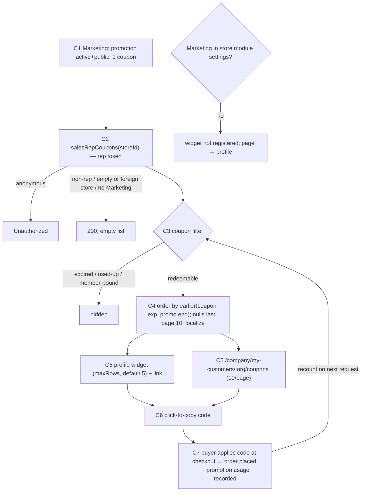
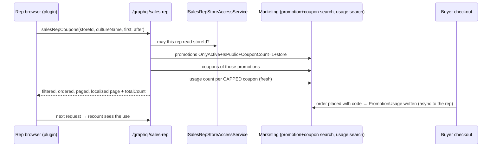

TEST MODEL — VCST-6158 (round 1, vcst)

Ticket:      VCST-6158 | Type: Story | Status role: testable (Ready for test → Testing) | Flow: feature-test | Priority: P2 (Medium) | Path: FULL | Changed: Both (module xAPI + storefront plugin + vc-frontend host card)
Context:     FULL — 1c ba-system-analyzer (source + kb + VirtoOZ + live API; rep-hub UI UNVERIFIED while the CDN served a stale plugin entry) · 1d ba-story-writer (Mode B) · 1r BLOCKED 15:53Z (KB-4358B2EC) → CDN cleared 16:07Z → REACHABLE 16:12Z in a fresh browser context (a browser that loaded the stale entry kept it from its OWN cache, max-age 4 h — the defect outlives a CDN purge). Live: widget 5 cards (CAT20, FREE, AIR, QA, WINE, all Unlimited), page 10 + pager (19 total), 0 console errors
Prior model: none — first model for the rep-coupons surface. Sibling surface model VCST-6314 (customer-profile quick actions/tasks) shares the profile and layout links; nothing carried forward but the chain position below.
Domain map:  .claude/knowledge/domain/sales-rep.md @ rev 3 (generated 2026-09-18, amended 2026-10-08) — PRESENT
Mind map:    .claude/knowledge/domain/sales-rep.mind-map.json — nodes touched: sr.profile, sr.store-toggle.off-hides-ui, sr.layout.widget-settings, sr.layout.hidden-widget-queries, sr.dashboard.widget-failure-isolation, sr.profile.customer-switch-isolation. DRIFT: no node for the coupons widget/page/query, the Marketing-optional gate, or guardCustomerModuleRoute (for /qa-test-mind-map update)
Chain position: domain chain (sales-rep.md §1) L1 rep created → L2 served orgs → L3 store toggle → L4 hub → L5 portfolio reads → L6 rep-as-buyer → L7 documents → L8 access removal → L9 reversal. This ticket ADDS a parallel read link "L5c — rep reads the store's public coupons on a customer profile" and TOUCHES L3 (a second gate: Marketing module) and L4 (profile layout block). It does NOT touch L1, L2 (served-ness only frames the page heading/not-found), L5a/L5b (statistics/orders families), L6, L7, L8, L9. It reaches OUT of the domain into marketing: the buyer's /account/coupons page and the cart sidebar share the changed host card.
Affected surface: vc-module-sales-rep#30 @ 1e103a45 — ExperienceApi SalesRepCouponsQuery/Builder/Handler, SalesRepCoupon (GetEndDate, Localize), SalesRepCouponType; module.manifest (Marketing optional 3.1009.0); StorefrontApp sales-rep-coupons.vue, coupon-list.vue, customer-coupons.vue, useSalesRepCoupons/…CustomerCoupons/…sConfig, coupons.ts, layout/coupons-block.ts, routes.ts (guardCustomerModuleRoute), 13 locales. vc-frontend#2596 @ e749b47f — shared/account/components/coupon-item(.vue|-skeleton.vue), core-api exports. Map coverage: profile §3 ✓; MISSING from the map: salesRepCoupons + type, layout block `coupons`, route /coupons, Marketing gate, shared route guard, host CouponItem export (1c unmapped_surfaces[] 1–8) → 5-docs-map.
Ticket signals:
  - Assignee comment 2026-10-22 OVERRIDES the description and mockup: no personalization, filters, audience badges or Apply to cart; store's public coupons; widget + "All promotion coupons" page paged by 10; host card + "N of M uses left"/"Unlimited"; hide expired + used-up; Expires = earlier(coupon expiry, promotion end), soonest first; no Marketing ⇒ widget hidden, page redirects to profile.
  - Mockup (attachment image-20261021-111146.png): filters/badges/Apply-to-cart crossed out; caption "Shows what this customer can redeem today…" obsolete (must not ship as UI text).
  - PR #30 body: list = promotionCoupons set (active, public, exactly ONE coupon) minus expired / used-up (fresh recount, not cached TotalUsesCount) / MemberId-bound; empty storeId refused; store access via ISalesRepStoreAccessService; paging in memory after filters.
  - 1r 15:53Z: stale Cloudflare remoteEntry.js (27 Oct build) → hub pages stuck "Loading page…" (KB-4358B2EC, 3rd sighting, suspected defect, no ticket).
Epic context: VCST-5142 Sales Rep Hub (In progress). Done seams: customer profile (suite 091), dashboard (093), plugin delivery (093b), scoped xAPI (050m), activity page (112 — its route guard was refactored into the shared factory here). Dependency: vc-frontend#2596 must ship before #30 (host ^0.2.5 gate; facade bundles 0.2.8).
Domains:     sales-rep (BL-SR), marketing/coupons (no BL domain — ECL-1.3, VC-PROMO-*), ui, a11y, gql
Flows & boundaries: Marketing admin → xAPI salesRepCoupons → plugin widget/page → host CouponItem ↔ buyer /account/coupons + cart sidebar (promotionCoupons) → checkout redemption → promotion usage → recount
Risk areas:  VC-PROMO-003 (code uppercased on card + copy) · KB-4358B2EC CDN stale plugin entry · buyer-page regression via the shared card · 13-way end-date tie across the page boundary · first:-1 returns 1 item (1c) · TZ-shifted date-only "Expires" · front gate (module settings list) vs back gate (IOptionalDependency) disagree
AC traceability: 14 ACs from the comment (AC-01..14) + 28 gap-ACs (G-01..28), each with Impl verdict — scratch 1d review; CONTRADICTS: AC-11 "same set as the buyer page"; DRIFT: AC-02 link always shown, AC-05 wording ("2 uses left out of 5" vs "N of M uses left"), AC-12 two gate signals, D-3 version gate ^0.2.5 vs 0.2.8
DoD: none declared on the ticket (1d proposed one; not binding)

--- Part 0 — VALUE CHAIN ---
Value chain:
  C1 A marketer publishes a promotion with ONE shared coupon in the store (active, public; coupon may carry expiry, total cap, member binding)
  C2 The rep's request asks for the store's coupons (salesRepCoupons(storeId), rep token, store access checked)
  C3 Only coupons a buyer can actually redeem survive: coupon not expired, cap not reached (uses counted NOW), not bound to a member
  C4 They are ordered by when they stop working (earlier of coupon expiry / promotion end), soonest first, no-end last, paged 10, localized
  C5 The rep sees them on the customer's profile (widget, N rows) and on "All promotion coupons" (10/page), on the host coupon card with the uses line
  C6 The rep copies a code and gives it to the buyer
  C7 The buyer redeems it at checkout; the order records a use → the next request's recount drops/updates the coupon (the async hop)
Chain diagrams:


```mermaid
stateDiagram-v2
  [*] --> Listed: public, active, 1 coupon, not expired, cap free, no member
  Listed --> Hidden_UsedUp: last use recorded (order placed)
  Listed --> Hidden_Expired: coupon expiry or promotion end passes
  Listed --> Gone: admin deletes coupon / makes promotion private or inactive
  Gone --> Listed: admin re-publishes
  note right of Hidden_UsedUp: NO way back — a cancelled order keeps its use (3x live CO261103-00001 + source CouponUsageRecordHandler; KB-650B8BFB)
```
Variants (union of the layers that branch — handler, plugin, host card):
  V1 uncapped, no end (Unlimited, no Expires) · V2 capped partial (N of M) · V3 capped, 1 left (singular) · V4 capped used up (hidden)
  V5 coupon expired, promotion active (hidden) · V6 coupon expiry < promotion end · V7 promotion end < coupon expiry · V8 member-bound (hidden)
  V9 not eligible by promotion: multi-coupon / private / inactive / future start / other store
  V10 caller: rep (served customer) · rep (unserved customer) · non-rep buyer · anonymous · rep on foreign/empty storeId
  V11 Marketing module absent · V12 culture: en-US / de-DE / none; plural classes (en 1/2, pt/fr 3-form, ru/pl 4-form)
  V13 count: < maxRows · > maxRows · exactly 10 · 11 · page shrinks under the rep · 19 with a 13-way tie
  V14 host-card consumer outside the ticket: buyer /account/coupons · cart sidebar coupons section
Mechanism coverage matrix (columns C1–C7 from the chain; rows V1–V14 from the branching layers; scenario #s mapped in after):
  | V \ C | C1 define | C2 request/gate | C3 filter | C4 order/page/l10n | C5 render | C6 copy | C7 redeem→recount |
  | V1 | S1 | S1 | S1 | S10 | S1,S14 | S1,S15 | WAIVED: uncapped has nothing to recount |
  | V2 | S2 | S1 | S2 | S10 | S2 | S15 | S3 |
  | V3 | S4 | S1 | S4 | S10 | S4 | WAIVED: same copy path as V2 | S3 |
  | V4 | S3 | S1 | S3 | n/a by construction (hidden) | S3 | n/a | S3 |
  | V5 | S5 | S1 | S5 | n/a (hidden) | S5 | n/a | WAIVED: time-driven, no use |
  | V6 | S6 | S1 | S6 | S6,S10 | S6 | WAIVED: copy independent of dates | WAIVED |
  | V7 | S7 | S1 | S7 | S7,S10 | S7 | WAIVED | WAIVED |
  | V8 | S8 | S1 | S8 | n/a (hidden) | S8,S32 | n/a | S32 (3x: the bound org's buyer CAN redeem it, others are refused) |
  | V9 | S9 | S9 | n/a (excluded at C2's search) | n/a | S9 | n/a | n/a |
  | V10 | n/a | S16,S17,S18,S19 | n/a | n/a | S17,S18 | n/a | n/a |
  | V11 | n/a | WAIVED: Marketing installed on every reachable stand; unit-tested in PR | WAIVED | WAIVED | WAIVED (same) | n/a | n/a |
  | V12 | S12 | S12 | n/a | S12 | S12,S13 | n/a | n/a |
  | V13 | S11 | S11 | S11 | S10,S11 | S11,S20,S21 | n/a | S21 (shrink after a use) |
  | V14 | n/a | S22 | n/a (buyer path unfiltered by design) | S22 | S22,S23,S24 | S23 | S23 |
Reverse edges:
  - Use recorded (forward: N left → N-1 / hidden) → cancelled order releases the use? → **ABSENT IN PRODUCT** (3x: count stayed 1 for 3 min after cancel; source never removes a usage) — a finding for the PO, guarded by S33
  - Time (expiry passes) → coupon disappears; no reverse except admin extending the date → S5 (forward), admin edit covered by suite 025, not re-tested
  - Admin unpublishes (private/inactive) → disappears; re-publish → reappears → S9
  - Layout: rep hides the coupons block → no query; restores → query again → S20
Fixture lifecycle: V3/V4 are TERMINAL once a use is recorded (a used-up coupon stays used) → the cap fixtures are created PER RUN inside the case (FIFTH RULE), never shared; V5/V6/V7 are time-relative → seeded relative to "now", re-seeded per run.

--- Part 0r — ROLE SCENARIOS (matrix carries 4 caller variants) ---
Roles in scope: rep serving the customer → @td(SR_REP_PRIMARY.email) · rep NOT serving the customer → same rep + @td(SR_UNSERVED_ORG.id) · non-rep buyer → {{ORG_USER_EMAIL}} · anonymous → no account. Advanced rep: same code path (no role branch in the handler/plugin) — WAIVED.
BSC-1 — A rep reads a customer's coupons before a call
  Role: rep (SR_REP_PRIMARY) · Situation: preparing a call with a served customer (TechFlow)
  | # | Action | Sees | Can do | Expected |
  | 1 | open My customers → TechFlow | profile with "Available coupons" | follow "All promotion coupons" | widget lists ≤ maxRows redeemable coupons |
  | 2 | open the page | 10 per page, pager when >10 | copy a code | code on clipboard + success notice |
  Outcome: the rep can hand the buyer a code the buyer can actually redeem
  Not allowed: expired / used-up / member-bound / non-public / multi-coupon promotions listed (S3,S5,S8,S9)
BSC-2 — A rep opens a customer they do not serve
  Role: rep · Situation: an old bookmark to an organization no longer served
  | 1 | open /company/my-customers/<unserved>/coupons | "customer not found" + back button | go back | no coupon list rendered |
  Outcome: no customer data leaks; the store list is store-wide anyway, so the page must not imply per-customer data
  Not allowed: the page rendering a customer heading for an unserved org (S17)
BSC-3 — A buyer or a visitor reaches the rep coupons
  Role: non-rep buyer / anonymous · Situation: shared link
  | 1 | open the coupons URL | redirected out of the rep area | — | salesRepCoupons not sent |
  | 2 | send salesRepCoupons directly | — | — | non-rep: 200 empty; anonymous: Unauthorized |
  Not allowed: any coupon returned to a non-rep at the SERVER with that caller's own token (S18, S19)

--- Parts 1–5 — FAULT MODEL ---
Condition space: coupon shape {V1..V9} (9) × caller {rep-served, rep-unserved, non-rep, anon, rep-foreign-store} (5) × surface {widget, page, API} (3) × culture {en, de, none, plural-3, plural-4} (5) × count {<rows, >rows, 10, 11, shrink} (5) × Marketing {on, off} (2) × host consumer {rep, buyer page, cart sidebar} (3). Constraints: V4/V5/V8/V9 have no render/copy (hidden); non-rep/anon have no surface but API; Marketing off unreachable. Raw N = 9×5×3×5×5×2×3 = 20,250.
Reduction: N → 31 (+3 from discovery: S32–S34; S28 declined → 33 live rows). (1) Coupon shape × surface: the filter and the end date are computed once on the server and rendered by one card — shapes are asserted at the API (all 9) and rendered once each on the PAGE; the widget re-uses coupon-list.vue, so it gets the journey + count rows only (S1,S11,S20). (2) Caller × anything: callers other than rep-served never reach C3–C6, so each is one row (S16–S19). (3) Culture collapses to the localisation fallback (S12) + plural classes (S13) — culture does not branch the filter. (4) Count is BVA on 10/11 + widget rows + shrink (S11,S21). (5) Marketing off WAIVED (no stand; PR unit tests). (6) Host consumer: buyer page + cart sidebar as regression rows S22–S24 — t=2 on (layout width × code length).
Test scenarios (31 rows)
  | # | Cell | Defect hypothesis | Archetype | Technique | Oracle | P |
  | S1 | [JOURNEY] rep-served, page+widget, V1/V2 mix, en | the chain breaks at a join: query OK but widget empty, link wrong org, or copy puts a different code on the clipboard | PARITY | FLOW | {SPEC} comment 2026-10-22 + PR #30 | Critical |
  | S2 | V2 capped partial | uses line computed from cached TotalUsesCount or Max−Total off by one | STALE | EP | {SPEC} "N of M uses left" (wording DRIFT D-1 noted) | High |
  | S3 | V4: last use recorded by an order in-case | used-up coupon still listed because TotalUsesCount is cached | STALE | ST | {SPEC} hide used-up, fresh recount (PR #30) | Critical |
  | S4 | V3 cap 1 left | "1 uses left" / "0 left" shown; singular plural wrong | BOUNDARY | BVA | {SPEC} + en plural rule | Medium |
  | S5 | V5 coupon expired, promo active | coupon-level expiry ignored (buyer path ignores it) | PARITY | EP | {SPEC} hide expired | High |
  | S6 | V6 coupon exp < promo end | Expires shows promotion end (buyer-path field) | PARITY | DT | {SPEC} earlier of the two | High |
  | S7 | V7 promo end < coupon exp | min() takes the wrong side or null-fallback swaps | BOUNDARY | DT | {SPEC} earlier of the two | High |
  | S8 | V8 member-bound | MemberId coupon listed to every rep | SCOPE | EP | {SPEC} PR #30 exclude MemberId | High |
  | S9 | V9 multi-coupon / private / inactive / future | eligibility widened beyond CouponCount=1 / IsPublic / OnlyActive | SCOPE | EP | {SPEC} PR #30 = promotionCoupons criteria | Medium |
  | S10 | order: distinct ends + nulls + ties | nulls first (buyer behaviour) or unstable tie order across reloads | BOUNDARY | EP | {SPEC} soonest first; ties by id (PR) | Medium |
  | S11 | count 10 / 11 on the page | pager off by one; page 2 repeats or skips a row at the tie boundary | BOUNDARY | BVA | {SPEC} paged by 10 | High |
  | S12 | culture de-DE / none | label/name not localized or null name rendered | MONEY | EP | {BL-SR-013} | Medium |
  | S13 | plural classes pt/ru | 3/4-form plurals collapse to 2 forms | MONEY | EP | {BL-SR-013} + CLDR | Low |
  | S14 | V1 no end date | "Expires" with an empty/epoch date | FALLBACK | EP | {SPEC} card hides Expires without end | Medium |
  | S15 | copy action | clipboard differs from shown code (uppercasing, VC-PROMO-003) | SILENT | EG | {BL}-less: ECL-1.3 row 5 — server case-insensitive | Medium |
  | S16 | rep, empty/foreign storeId (API) | every store's coupons returned | SCOPE | EP | {SPEC} PR #30 empty storeId refused; BL-GQL-004 | Critical |
  | S17 | rep, unserved customer page | customer heading rendered / coupons implied for unserved org | SCOPE | EP | {BL-SR-002} + {SPEC} not-found state | High |
  | S18 | non-rep buyer (UI + API) | non-rep gets coupons or a 500 | SCOPE | DT | {BL-SR-011} + KB-3F3D3C6B | High |
  | S19 | anonymous (API) | anonymous gets data | SCOPE | EP | {BL-GQL-004} | High |
  | S20 | widget maxRows + hide block | widget ignores maxRows; hidden block still queries | CONFIG | EP | {BL-SR-031}, {BL-SR-025} | Medium |
  | S21 | page 2, coupon used up elsewhere → list shrinks | page shows empty page 2 instead of clamping | LIFECYCLE | ST | {SPEC} PR clamp | Low |
  | S22 | buyer /account/coupons before/after #2596, xs/md/lg/2xl | shared-card edit changes the buyer card (shadow, description, layout) | RENDER | PW | {BL-UI-003},{BL-UI-005} + pre-change baseline | High |
  | S23 | cart sidebar coupons section | sidebar card breaks or copy/apply regresses | PARITY | EG | suite 077b baseline | Medium |
  | S24 | long code (40+ chars) widget/page/buyer at 375/1280 | code overflows the button / horizontal scroll | RENDER | BVA | {BL-UI-004} + PR "wraps" | Medium |
  | S25 | loading/empty/error states + live region | stale rows on error; no announcement | RENDER | EG | {BL-A11Y-004},{BL-SR-012} | Medium |
  | S26 | keyboard + names + target size | copy buttons indistinguishable to SR; targets < 24px | RENDER | EG | {BL-A11Y-001/002},{BL-UI-006} | Medium |
  | S27 | compact vs regular by container width | compact switches on viewport, not card width | RENDER | BVA | {SPEC} #2596 container query 42rem | Low |
  | S28 | first:-1 / first:0 / after beyond total (API) | DECLINED for this ticket (3x): platform-wide paging — promotionCoupons does the same (first:-5 → 5); kept as an observation, no case | BOUNDARY | BVA | {OBSERVED} first:-1→1, first:-5→5, after:"-3"→10 rows | — |
  | S29 | Expires date in a non-UTC browser TZ | the card shows a calendar day on which the code never works (3x: ZUR10 ends 2027-05-31T22:00Z, CET browser shows "Jun 1, 2027") | MONEY | BVA | {SPEC}-derived: the date shown is never AFTER the last day the code works (reference TZ = PO question) | Medium |
  | S32 | V8: member-bound coupon × bound-org buyer vs other-org buyer at checkout + bound org's rep page | the bound org's own coupons page hides the one code that org can redeem; other orgs are refused | SCOPE | DT | {OBSERVED} cart −$0.60 for TechFlow, "not valid" for Monday Org; listing rule = PO question (AC-11 says account-issued coupons are not shown) | Medium |
  | S33 | V2 capped coupon used by an order in the case, order cancelled | rep count recovers (or not) after cancel — the rep promises a use that is gone, or none that exists | LIFECYCLE | ST | {OBSERVED} use NOT released (source + live); intended behaviour = PO question | Medium |
  | S34 | uses-line number formatting | large caps render without locale grouping ("9961 uses left out of 10000") | MONEY | EP | {BL-SR-013} localization; {OBSERVED} no grouping | Low |
  | S30 | activity page after guard refactor | guardCustomerModuleRoute breaks the Activities page redirect | CONFIG | EG | suite 112 baseline | Medium |
  | S31 | no obsolete UI text / removed features | filters, badges, Apply to cart or mockup caption shipped | PARITY | EP | {SPEC} AC-14 | Low |
Probes carried in: VC-PROMO-003 → S15 · VC-PROMO-001/002/004 → N/A (no coupon applied by this feature; S23 only re-checks the sidebar) · KB-4358B2EC (CDN) → not a scenario: environment/delivery defect, filed separately at 5-file
Archetype sweep: SCOPE S8,S9,S16–S19 · PARITY S1,S5,S6,S23,S31 · STALE S2,S3 · RACE WAIVED (read-only list; recount race = S3 timing, no double-submit) · REPLAY WAIVED (no write) · SILENT S15 · MONEY S12,S13,S29 · BOUNDARY S4,S7,S10,S11,S28 · LIFECYCLE S21 · CONFIG S20,S30 · FALLBACK S14 · RENDER S22,S24–S27
UIP sweep: UIP-BACK S11 (page number not in URL → back/reload returns page 1; asserted, not a defect) · UIP-DEEP S17 · UIP-REFRESH S11 · UIP-TABS WAIVED (no cross-tab state) · UIP-EXPIRE WAIVED (session expiry generic, suite 089) · UIP-STORAGE WAIVED (no client storage) · UIP-NET S25 · UIP-INPUT WAIVED (no input) · UIP-VIEW S24,S27 · UIP-DATA S24 · UIP-PAGE S11 · UIP-EXTREME S24
Business Rules: BL-SR-002, BL-SR-011, BL-SR-012, BL-SR-013, BL-SR-025, BL-SR-031, BL-GQL-003, BL-GQL-004, BL-UI-003, BL-UI-004, BL-UI-005, BL-UI-006, BL-A11Y-001, BL-A11Y-002, BL-A11Y-004
Edge cases: ECL-1.3 (coupon case), ECL-7.3/7.4 (loading race, mobile layout), ECL-14.1 (200 + errors), ECL-14.8 (consumer version gate)
Docs grounding: StorefrontUserGuide "Coupons and Promotions" (buyer page only); no doc page for the rep feature (NEW) → {SPEC} = Jira comment + PR README; PlatformUserGuide "Manage Promotions" does not define coupon expiry vs promotion end or caps (released-doc gap)
Observed grounding: KB-50CD6A34, KB-F0C5CA5E, KB-1C28E89D (relied), KB-3F3D3C6B (listed), KB-4358B2EC (confirmed this run); kb_none on salesRepCoupons
Agents to dispatch: 3a test-data-engineer (promotions seeder) · 3x /qa-exploratory ticket (charter below) · 4a qa-frontend-expert (chrome) + qa-backend-expert (edge, API rows) · 4v vc-test:ui-ux-expert · A test-management-specialist
3x charter sources: matrix GAP V8×C7 · reverse edge "cancelled order releases a use" · {HYPOTHESIS} S28, S29 · 1d DRIFT AC-02 (link on empty), AC-05 (wording), AC-12 (two gate signals), CONTRADICTS AC-11 · RE-BASE rows from 2a
3x amendments (SBTM-VCST-6158-2026-11-03.md): V8 hidden ≠ obviously correct (bound org can redeem) → S32 + PO question · cancel never releases a use → reverse edge ABSENT, S33 · V13 "list shorter than the row setting" unreachable while the store has ≥20 coupons (row setting clamps 1–20) · S28 declined (platform) · S29 confirmed and sharpened · promotion-level total limit not enforced (platform, DECLINED here, routed to triage) · CDN purge did not hold at one edge (4th KB-4358B2EC sighting).
FIXTURE-GAP: none for roles; data gaps (V3,V4,V5,V7,V8, long code, 10/11 counts, future-start) → 3a
