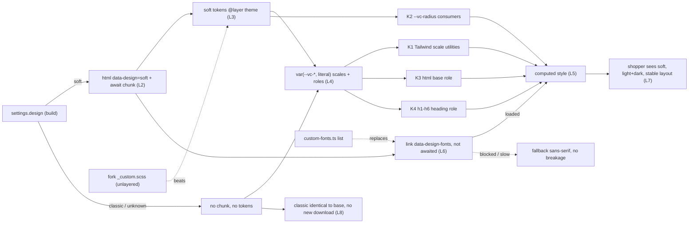

# TEST MODEL — VCST-6232

Ticket:      VCST-6232 | Type: Task | Status role: testable | Flow: feature-test | Priority: P1 (High) | Path: FULL | Changed: Frontend (vc-frontend theme only)
Shape class: ui-kit (ticket-routing.md §5c) — no Artifact-A authoring, no 3-cases, no C1; carrier-first matrix (ui-kit-class.md §1)
Build:       vc-frontend#2600 @ a4f29534 (base dev 4ce61d0c) — the SAME build round 1 (Sprint26-21, FAST) failed on AC-2; no commit since
Context:     FULL: ba-system-analyzer (1c) + ba-story-writer Mode B (1d) + 1r REACHABLE
Prior model: none — round 1 was FAST and wrote no model; its checklist (reports/tickets/Sprint26-21/VCST-6232/vcst/testing-checklist.md) is carried in as prior art, each row re-run, never trusted
Domain map:  ABSENT (no .claude/knowledge/domain/ file for the design system; all_layer_chain false ⇒ no 1c-map build; recommend /qa-domain-map design-system)
Mind map:    ABSENT
Chain position: unverified — no domain map. Inside this ticket's own chain: touches L1–L8 (below); does NOT touch platform settings, xAPI, presets' colour tokens (out of scope: colour), component-level tokens or component literals (out of scope per ticket)
Affected surface: vc-frontend storefront theme — tailwind.config.ts:6-35,225-226,229,313-332 · client-app/assets/styles/_typography-roles.scss · preflight.scss:2,10 · storybook-styles/preflight.scss · core/utilities/design/index.ts:29,63,72,94 · app-runner.ts:84-86 · designs/soft/{_tokens.scss,index.scss,design.ts,blocks/footer-links.scss} · designs/custom-fonts.ts · core-api/contract/{tailwind-preset.cjs,index.d.ts,package.json 0.2.7} · .storybook/preview.ts:294-300 · styles README. Map MISSING all of them (no map).
Ticket signals: round-1 QA FAIL comment (AC-2 not met: soft sets radius, fonts, footer case only); ticket moved Reopen→Ready for test 2026-11-02 08:59 UTC with no commit/comment; priority Medium→High during round 1; 2 attachments are round-1 soft screenshots (home light 1280, orders filters 1280); PR body "Soft's other values wait for the designer"; ticket §Blocked by (design).
Epic context: VCST-6135 Paprika Next Theme (In progress). Done prerequisite VCST-6231 (#2577, design switch + cascade layers) = seam. Consumers in progress / to do: VCST-6289 (#2620 VcWidget soft), VCST-6508 (CJK soft fonts), VCST-6493, VCST-6517, VCST-5902, VCST-5923.
Domains:     storefront design system / theme tokens (no repo domain slug) · BL domain `ui`
Flows & boundaries: build setting → design chunk → tokens → utilities/roles → computed style; Storybook design toolbar; fork override (_custom.scss unlayered, custom-fonts.ts); Builder/CMS content; print; payment iframes
Risk areas:  VC-UI-001 (gated presets), VC-UI-005 (BL-UI-001..006 layout invariants, all SUSPECT), VC-UI-006 (long value in flex cell), VC-UI-007 (non-en locale), VC-UI-002 (mobile menu re-mount)
AC traceability: 5 story ACs → 27 atomic conditions incl. gap-ACs (1d seed): AC-1 SATISFIED(static) · AC-2 DRIFT (radius) / SATISFIED (fonts) / NOT-FOUND (shadow, size+lh, weight, spacing, italic, case-role, dark) · AC-3 SATISFIED · AC-4 SATISFIED · AC-5 SATISFIED w/ caveats · gap-AC-1..14
DoD: none declared on the ticket

--- Part 0 — VALUE CHAIN ---
Value chain:
  L1 a store owner builds the theme with settings.design = soft (build time; classic when unset/unknown)
  L2 app start writes <html data-design="soft"> and awaits the design's index.scss chunk before mount
  L3 the chunk sets the design's tokens in @layer theme (soft: --vc-radius, --vc-base-font-family, --vc-heading-font-family) and its block rules in @layer vc.design
  L4 every Tailwind scale key and role rule resolves var(--vc-<prop>-<key>, today's literal) — set ⇒ design value, unset ⇒ classic literal
  L5 the element's computed style changes on each CARRIER that reads the token
  L6 soft only: loadDesignFonts adds ONE link[data-design-fonts] (Inter + Geologica), not awaited; blocked ⇒ generic sans-serif
  L7 the shopper sees the soft shape/typography on every page, light and dark, without layout shift or overflow
  L8 classic (no design tokens set) renders exactly as before, in every preset, light and dark, and downloads nothing new — what this unlocks: sibling component tickets and forks override tokens instead of templates

Chain diagrams:

Variants (the CARRIERS — the code paths that deliver a shape/typography value; union of what tailwind.config.ts, preflight/_typography-roles, component SCSS and the Storybook preview branch on):
  K1 Tailwind scale utility → var(--vc-<scale>-<key>) (rounded*, shadow*, text-*, leading-*, font-<weight>, tracking-*)
  K2 --vc-radius consumers (component tokens --vc-*-radius, rounded-[--vc-radius] ×41)
  K3 bare html → font-base → --vc-base-font-family
  K4 bare h1–h6 → font-heading + --vc-heading-{font-weight,font-style,text-transform,letter-spacing}
  K5 component-owned typography (VcTypography 700/uppercase via --vc-typography-*, Builder .builder-block h1–h6 @apply)
  K6 component literals (12 font-size, 13 line-height, 8 letter-spacing, 7 box-shadow, 92 radius) — out of scope per ticket
  K7 inline style / CMS content stacks
  K8 print layer + bulk-results print window (literal font-lato)
  K9 Storybook preview (design toolbar, docs fontBase)
  K10 payment secure-field iframes (system font by design)
  K11 design block rule (soft footer-links title case)
  K12 fork override (unlayered _custom.scss token; custom-fonts.ts list)

Mechanism coverage matrix (rows = carriers, columns = links; cell = scenario # | GAP | WAIVED + reason):
| Carrier | L2 switch | L3 token set | L4 resolve | L5 computed | L6 fonts | L7 seen/stable | L8 classic same |
|---|---|---|---|---|---|---|---|
| K1 scale utility | 1 | 5,6,7,8 | 11 | 5,6,7,8 | WAIVED: K1 carries no font file | 16 | 2,12 |
| K2 --vc-radius | 1 | 4 | 4 | 4 | WAIVED: no font | 1,16 | 2 |
| K3 html base | 1 | 1 | 1 | 1,14 | 14,15 | 15,16 | 2,13 |
| K4 h1–h6 role | 1 | 9 | 9 | 9,17 | 14 | 17 | 2,17 |
| K5 component typography | 1 | 17 | 17 | 17 | 14 | 17 | 2 |
| K6 component literals | WAIVED: out of scope (ticket) | WAIVED: out of scope | WAIVED | 4 (observed, no expectation) | WAIVED | 16 | 2 |
| K7 inline/CMS | 1 | WAIVED: content-owned | WAIVED | 17 | 14 | 16 | 2 |
| K8 print | 19 | 19 | 19 | 19 | 19 | 19 | 19 |
| K9 Storybook | 20 | 20 | 20 | 20 | 20 | 20 | 21 (PIXEL) |
| K10 payment iframe | WAIVED: cross-origin iframe, system font by design (payment-processing-cyber-source.vue:343) | WAIVED | WAIVED | WAIVED | WAIVED | WAIVED | WAIVED |
| K11 block rule | 1 | 10 | 10 | 10 | WAIVED: no font | 1 | 2 |
| K12 fork override | 23 | 23 | 23 | 23 | 23 | GAP: no fork build on the stand — unit tests only | 23 |
Dark mode is a factor on rows 1, 2, 10 (not a carrier). Preset is a factor on rows 2, 3.

Reverse edges (no money/stock/entitlement moves; the reversible effects are design and font state):
  soft→classic in Storybook removes the font link and soft values → 20
  fork override reverses a design value / font list → 23
  dark→light toggle restores light values → 1, 10
Fixture lifecycle: no terminal state. Data: anonymous pages + existing ORG_USER_EMAIL (signs in, verified at 1r); no seeding (data_surface false).

--- Parts 1–5 — FAULT MODEL ---
Condition space:
  design {classic, soft, fork-override} · build {BASE 4ce61d0c, PR a4f29534} · preset {red, coffee (gated), ungated} · mode {light, dark}
  family {radius, shadow, font family, size+line-height, weight, letter spacing, italic, case} (8) · carrier K1–K12 (12)
  viewport {375, 768, 1024, 1280, 1920} · surface {storefront, Storybook, print} · font load {ok, slow, blocked} · locale {en, non-Latin}
  constraints: soft exists only on the local build (design fixed at build time); classic-PR on vcst + local; BASE only local/classic; K10 unreachable; fork override needs a fork build
  raw cells N = 3×2×3×2×8×12×5×3×3×2 = 233,280
Reduction (N → 26): carrier-first (ui-kit §1) — family collapses INTO carrier (each family has one scale carrier K1 or role K4, so family×carrier is 8+4 meaningful cells, not 96); preset collapses to {red live, coffee derived + Storybook} because presets carry no shape/typography key (C-1b, source-confirmed) — the preset cannot interact with a token it does not set; build×design collapses to {classic-PR vs classic-BASE, soft-PR vs classic-BASE}; viewport kept only on the layout rows (16) where BL-UI-004/005 bind; font-load {slow, blocked} only on K3 (the only carrier the font file reaches first); locale only on K3/K4 (glyph coverage); K10 dropped (WAIVED, unreachable); fork override collapsed into one row backed by the unit tests.

Test scenarios (26 rows)
| # | Cell | Defect hypothesis — what breaks, and why plausibly | Archetype | Technique | Oracle | P |
|---|---|---|---|---|---|---|
| 1 | soft-PR, red, light→dark, signed in, home→/catalog→PDP→/cart→/account/orders→footer; one observation per Goal family on its carrier | [JOURNEY] the design takes effect on some pages/carriers and not others (chunk not awaited on a deep route, dark toggle drops tokens) — the end-to-end "does soft work at all" | CONFIG | FLOW | {SPEC} Goal + AC-2 (every family soft, light+dark) | P1 |
| 2 | classic-PR vs classic-BASE, red, light+dark, 6 pages × 1280 + 375; every typography/shape computed property on every text/box element | a var() fallback differs from the old literal (typo, unit, rem↔px, new DEFAULT key) → AC-1 regression on every customer | PARITY | EP | {SPEC} AC-1 | P1 |
| 3 | classic, coffee | a preset sets a shape/typography key so classic changes per preset | CONFIG | EP | {SPEC} AC-1 "any preset" + {DOC} presets = colour (VirtoOZ Visual Theme Customization) — derived from presets/*.json + Storybook coffee sanity | P2 |
| 4 | soft K2 vs K1 vs K6 radius | soft radius is uneven: --vc-radius consumers 16px beside rounded* 4px and literals, because --vc-radius is not chained to --vc-radius-* | SILENT | EG | {SPEC} AC-2 radius "per role" + Goal | P2 |
| 5 | soft K1 shadow steps light+dark | soft sets no shadow token ⇒ shadows are classic | SILENT | EP | {SPEC} AC-2 | P2 |
| 6 | soft K1 font sizes + line heights | no size/line-height token ⇒ classic type scale | SILENT | EP | {SPEC} AC-2 | P2 |
| 7 | soft K1 font weights | no weight token ⇒ classic | SILENT | EP | {SPEC} AC-2 | P2 |
| 8 | soft K1 letter spacing | no spacing token ⇒ classic | SILENT | EP | {SPEC} AC-2 | P2 |
| 9 | soft K4 italic + case + heading weight/spacing roles | role tokens exist but soft sets none ⇒ inherit | SILENT | EP | {SPEC} AC-2 + Scope "role tokens" | P2 |
| 10 | soft K11 + dark | soft has no dark block ⇒ no dark values at all; footer block rule only in light? | CONFIG | EP | {SPEC} AC-2 "light and dark" | P2 |
| 11 | compiled CSS of the soft build: each scale utility wraps var(--vc-<prop>-<key>, literal) | a scale is NOT tokenised (missed key, purge, preset not regenerated) ⇒ a design can never change it — the architecture half of AC-2 | SILENT | DT | {SPEC} Scope "Tailwind scales read the tokens" | P2 |
| 12 | shadow-<colour> utility compiled from the tokenised scale | Tailwind cannot parse var() parts ⇒ --tw-shadow-colored loses geometry ⇒ coloured shadows break in classic (forks/CMS) | FALLBACK | EG | {SPEC} AC-1 + README claim | P2 |
| 13 | classic-PR cold load (vcst + local), / PDP /cart | classic requests Inter/Geologica or adds link[data-design-fonts] | CONFIG | EP | {SPEC} AC-3 | P1 |
| 14 | soft cold + warm load | font link added twice / never / faces not actually used (fallback rendered) | FALLBACK | EP | {SPEC} Scope "soft fonts load only with design soft" | P2 |
| 15 | soft, font stylesheet slow (3 s) and blocked | page waits for fonts (blank) or breaks; swap adds CLS > 0.1 | FALLBACK | EG | {BL} BL-UI-001 + {SPEC} README "not awaited" | P2 |
| 16 | soft vs classic at 375/768/1024/1280/1920, long names, mobile menu | wider Inter/Geologica overflow containers or misalign button rows | RENDER | BVA | {BL} BL-UI-004, BL-UI-005 | P2 |
| 17 | soft K4/K5/K7: h1–h6 (incl. h4–h6), VcTypography, Builder headings | heading role misses h4–h6 or is beaten by component rules; classic h4–h6 change | PARITY | EP | {SPEC} AC-1 + AC-2 | P2 |
| 18 | soft, non-Latin locale available on the store | Geologica/Inter lack glyphs ⇒ tofu or mixed fallback | RENDER | EG | {HYPOTHESIS} fallback without tofu (gap-AC-5) — becomes {SPEC} when VCST-6508 defines per-locale soft fonts; CJK out of scope (VCST-6508) | P3 |
| 19 | print emulation cart + order details, classic and soft | print layer drops tokens or classic print changes | PARITY | EP | {SPEC} AC-1 (classic print = BASE) · soft print: no oracle until design hands off print values — stated, never graded | P3 |
| 20 | Storybook PR: Classic→Soft→Classic, Canvas + Docs | stale font link / docs font not following design / toggle not reversible | STALE | ST | {SPEC} PR scope (Storybook toolbar) | P3 |
| 21 | Storybook BASE vs PR, design Classic, PIXEL | a token fallback changes a component's pixels nobody names | PARITY | EP | {SPEC} AC-1 | P1 |
| 22 | soft vs classic-BASE runtime --color-* light+dark + source grep | soft sets or shifts a colour token | CONFIG | EP | {SPEC} AC-4 | P2 |
| 23 | fork override: _custom.scss token beats soft; custom-fonts.ts list replaces (incl. []) | layer order lets a design beat a fork, or the fork list is merged not replaced | CONFIG | DT | {SPEC} Scope "how forks override" + README | P3 |
| 24 | styles README §Shape and typography tokens walked as a developer | doc omits a step or contradicts the code/token table | SILENT | EG | {SPEC} AC-5 | P2 |
| 25 | core-api contract: tailwind-preset.cjs fallbacks = old literals; facade 0.2.7; SeoInfo optionality | forks on the facade get a different preset or a type break | PARITY | EP | {SPEC} Fork impact | P3 |
| 26 | NEGATIVE CONTROL: the row-2 diff harness run soft-PR vs classic-BASE | harness reports 0 differences even when a known difference exists (font family, --vc-radius) ⇒ row 2's PASS proves nothing | SILENT | EG | {SPEC} harness must report the known soft diffs (ui-kit §3) | P1 |
Rows 4–10 keep the SPEC expectation (soft value present); the build is known not to meet it (round 1 + source). Rule 3: no row is flipped to the observed classic value.

Probes carried in: VC-UI-001 → 3 (red live, coffee derived; ungated preset informational) · VC-UI-005 → 15, 16 · VC-UI-006 → 16 · VC-UI-007 → 18 · VC-UI-002 → 16 (375 mobile menu) · VC-UI-003/004 N/A (no table row-click, no state-dependent layout under test)
Archetype sweep: PARITY → 2, 17, 19, 21, 25 · CONFIG → 1, 3, 10, 13, 22, 23 · FALLBACK → 12, 14, 15 · RENDER → 16, 18 · SILENT → 4–9, 11, 24, 26 · STALE → 20 · BOUNDARY → 16 (viewport BVA) · SCOPE WAIVED (no tenancy/permission) · RACE WAIVED (no read-then-write) · REPLAY WAIVED (no effect) · MONEY WAIVED (no price/currency; culture covered by 18) · LIFECYCLE WAIVED (no entity lifecycle)
UIP sweep: NET → 15 · VIEW → 16 · REFRESH → 14 (cold vs warm) · STORAGE → 1 (dark-mode toggle persisted) · DEEP → 1 (deep route /account/orders signed in) · BACK WAIVED (no state per history entry) · TABS WAIVED (design is build-time, no cross-tab state) · EXPIRE WAIVED (no session-bound styling) · INPUT WAIVED (no input under test) · DATA WAIVED (no data shape under test; long-name stress in 16)
Business Rules: BL-UI-001, BL-UI-004, BL-UI-005 (BL-UI-002 not touched: spacing scale unchanged by the diff; BL-UI-006 not touched today)
Edge cases:  ECL-7.1 (browser/device), ECL-7.3 (font/asset load), ECL-7.4, ECL-14.10
Docs grounding: VirtoOZ StorefrontDeveloperGuide "Visual Theme Customization" — presets = colours, --vc-radius default 0.5rem, recommended max 10px (soft sets 16px: doc↔build disagreement, a note for the author), overrides in _custom.scss. Design setting / scale & role tokens / custom-fonts.ts are NEW — undocumented; ground truth = ticket AC + styles README + source + live.
Observed grounding (kb): KB-6E8D796E (soft font link), KB-F7D6C16B (footer case), KB-279E8887 (vcst CDN inlines Lato ⇒ no googleapis request on vcst), KB-0AF3B0BB (pre-existing CLS 0.25–0.5), KB-9BCB34C7 (soft sets 3 tokens — source, this run)
Agents to dispatch: 3x discovery — qa-testing-expert (playwright-firefox) · 4a checklist — qa-frontend-expert (playwright-chrome) · 4v visual — vc-test:ui-ux-expert (playwright-edge) + PIXEL (scripts) · no authoring (ui-kit)

Exploratory charter feed (unresolved): K12 L7 GAP · row 12 (coloured shadow, unverified by 1d — compile denied) · row 18 {HYPOTHESIS} · AC-2 DRIFT/NOT-FOUND families (rows 4–10) · 1d DRIFT radius unevenness · Builder/CMS headings (K7) · SeoInfo hunk (scope creep) · 1rem vs documented 10px max

--- Amendments from 3x (exploratory/SBTM-VCST-6232-2026-11-02.md) ---
K7 split: K7a real CMS headings (.builder-block h1–h6) follow the heading role (Geologica 700) · K7b Builder text blocks (div.builder-text) keep `Lato, -apple-system, …` from the Builder SDK's unlayered per-block <style>, which beats every layered token; classic looks unchanged only because the authored font IS Lato. → row 17 covers K7a; new row 27 covers K7b.
K10: iframe content unobservable on localhost (CSP frame-ancestors allows only the vcst origin); the CyberSource wrappers' `rounded-[3px]` is a K6 literal on a revenue surface → evidence for row 4.
K13 (new carrier): elements with `line-height: normal` (form inputs) change their line box with the font family, no token involved (19→20px, 13 inputs, Firefox; Chromium reports the string `normal`) → new row 28.
Row 12 RESOLVED (static, compiled PR CSS): `--tw-shadow-colored` hard-codes the classic geometry per step ⇒ classic safe (AC-1 holds); a design's --vc-shadow-* never reaches a coloured shadow ⇒ latent finding vs README "a design changes geometry and alpha".
Row 18 GROUNDED: {OBSERVED} /ru/catalog (ru-RU) — Inter + Geologica Cyrillic faces (U+0400–045F) loaded, body Inter, h1 Geologica, no tofu. Greek not exercised (no Greek UI strings).
Row 4 GROUNDED live: unevenness a shopper sees — /cart coupon cards 4px inside the 16px coupon widget; CyberSource card number + CVV 3px beside 16px Cardholder/Expiry (Expiry and CVV share one row); account-nav active item 6px inside a 16px widget.
Rows 5–10 GROUNDED live: soft vs classic-BASE home 1920, 1196 (light) / 1177 (dark) DOM-path pairs: 0 differences in shadow, size, weight, letter spacing, italic, heading case; differences only font family, --vc-radius consumers (76 el 8→16, 26 el 6→14), 7 footer titles, K13 inputs. Soft dark vs soft light: shadow colour only.
K12: still GAP live (no fork build); source reading confirms _custom.scss is unlayered and getDesignFonts replaces (`ownValue(custom) ?? configs ?? []`).
Added rows:
| 27 | soft, Builder text blocks (K7b) on Builder pages | third-party unlayered CSS keeps Lato in soft and re-downloads Lato 400/700/900 — soft never reaches CMS body/section text | CONFIG | EG | {SPEC} Goal "the whole storefront" + AC-2 — whether CMS content is in "the whole storefront" is a question for the author | P3 |
| 28 | K13 `line-height: normal` inputs, soft vs classic, Firefox + Chromium | input line box changes with the font, no token involved; a Chromium-only computed diff cannot see it | RENDER | EG | {BL} BL-UI-005 (row height parity) | P3 |
