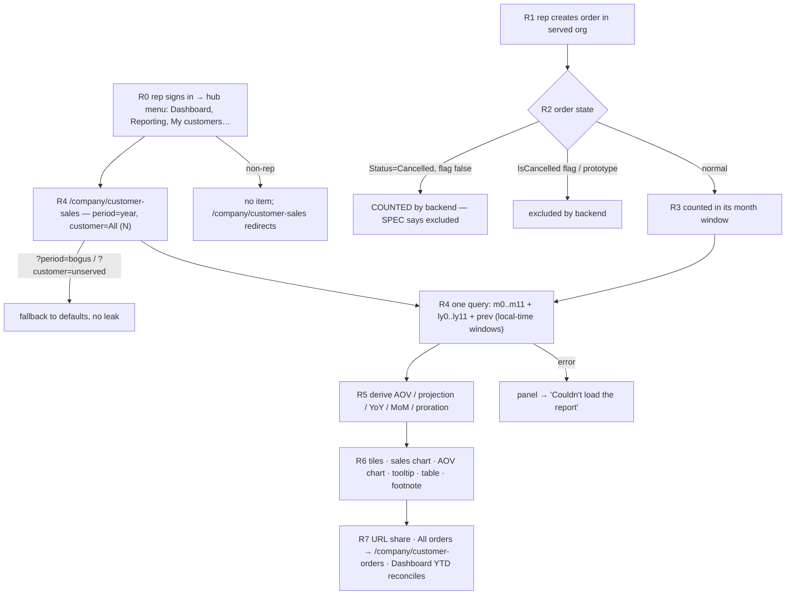
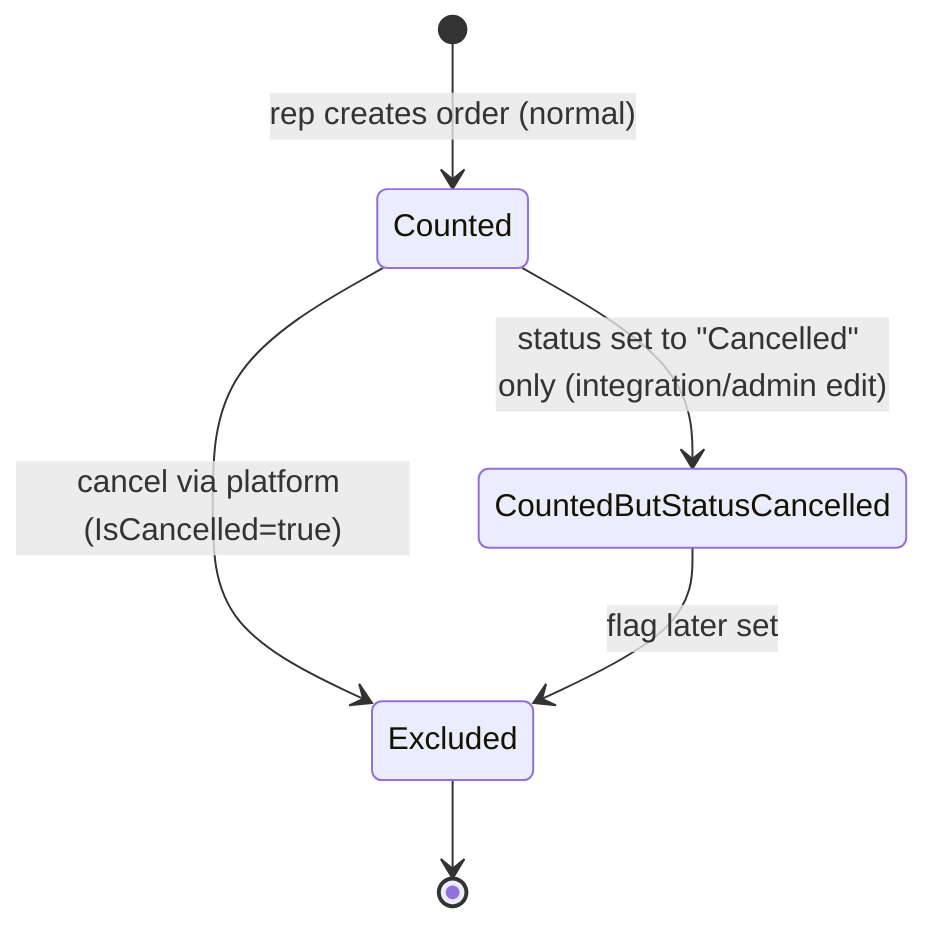

TEST MODEL — VCST-6255
Ticket:      VCST-6255 | Type: Story | Status role: testable | Flow: feature-test | Priority: P1 | Path: FULL | Changed: Frontend (MF plugin) on an unchanged backend contract
Context:     FULL: ba-system-analyzer (1c) + ba-story-writer Mode B (1d), 2026-11-03
Prior model: none — first model for this surface (reports/ba/test-models/ has no sales-rep reporting model; VCST-6257/6258 siblings have none yet)
Domain map:  .claude/knowledge/domain/sales-rep.md @ rev 3 (generated 2026-09-18, amended 2026-10-08) — PRESENT
Mind map:    .claude/knowledge/domain/sales-rep.mind-map.json — sr.stats, sr.stats.period-bounds, sr.stats.currency,
             sr.stats.excluded-orders, sr.scope.creator-only-statistics, sr.dashboard.kpi-row, sr.hub.basic-rep,
             sr.hub.non-rep-direct-url, sr.dashboard.kpi-no-data. DRIFT: no node for the Reporting page, its route,
             the client-side derivations (projection, YoY, proration) or the per-browser Last-year switch.
Chain position: touches L4 (hub renders — a NEW 2nd menu item) and L5a (statistics family, creator-scoped) of the
             domain chain L1–L9; reads L2 (served orgs → "All my customers (N)") without changing it.
             Does NOT touch L1 (rep creation), L3 (SalesRep.Enabled — read as a guard only), L5b (customer-orders
             family — only linked to via "All orders →"), L6 (rep as buyer), L7 (documents), L8–L9 (access removal).
Affected surface: vc-module-sales-rep StorefrontApp @ 9f009dd9 (deployed as VirtoCommerce.SalesRep 3.1017.0-pr-28-9f00):
             routes.ts / constants.ts (route /company/customer-sales), index.ts (nav item), pages/reporting.vue,
             components/reporting-*.vue, sales-rep-chart/*, reporting.ts, composables/useSalesRepReporting.ts,
             useReportingQueryParams.ts, useSalesRepCustomerOptions.ts, useToday.ts, cache-policies.ts,
             queries/salesRepMonthlyOrderStatistics.graphql. Backend UNCHANGED: Query.salesRepCustomerOrderStatistics
             on POST /graphql/sales-rep. Map MISSING: /company/customer-sales, the Reporting menu item, the
             SalesRepMonthlyOrderStatistics operation, the Last-year switch storage (→ 5-docs-map, clause 11b).
Ticket signals: route moved to /company/customer-sales by VCST-6668 (ticket text still says /company/reporting —
             live: /company/reporting 404s for a rep) · mock mode removed (comment 2026-10-29) · card title is
             "Sales statistics" not "My sales" · the "Cancelled slice safety net" is NOT in the code (no filter var;
             a unit test asserts it) · attachment = early chart reference, Target/orders-on-AOV out of scope.
Epic context: VCST-5142 Sales Rep Hub (In progress). Done siblings = seams: VCST-6647 (report body extracted to
             reporting-panel), VCST-6668 (route split), hub Dashboard (same statistics op → YTD must reconcile).
             In-progress: VCST-6257 (customer-profile chart, stacked on this PR — reuses reporting-panel),
             VCST-6258 (buyer-side chart), VCST-6674 (backend perf of 25-alias query) — none block this slice.
Domains:     Sales Rep (BL-SR), Orders (statistics), UI/A11Y.
Flows & boundaries: order creation (rep as creator) ↔ statistics cache ↔ plugin query ↔ client derivation ↔ render;
             Reporting ↔ Dashboard (same op, YTD); Reporting → /company/customer-orders (creator-agnostic list).
Risk areas:  VC-PLATFORM-005 (date/UTC month shift) · BL-SR-004/005 carry SUSPECT notes (REG-2026-10-27-SR-SWEEP) ·
             EUR "¤" formattedAmount (page formats from amount) · shared Apollo statistics type-policies (cache bleed).
             ENV: Cloudflare caches a stale remoteEntry.js variant for Chromium's Accept-Encoding (max-age 14400) —
             chrome/edge lanes load the pre-deploy plugin until ~2026-11-04 02:25Z; firefox lane is current.
AC traceability: 36 atomic conditions — AC1a-c, AC2, AC3a-e, AC4a-b, AC5, AC6a-c, AC7, AC8a-b, AC9, AC10a-f
             (1d split) + gap-ACs G1, G4, G5, G6, G7, G8, G9, G10, G12, G15, G16, G17, G18, G23. Impl verdicts:
             AC1 CONTRADICTS (path) · AC4 CONTRADICTS for status-only Cancelled (1c: live $80 order counted) ·
             card title DRIFT · AOV projection outline DRIFT · all others SATISFIED/UNVERIFIED-live.
DoD:         none declared (1d lists implicit items — confirm-at-5-verdict).

--- Part 0 — VALUE CHAIN ---
Value chain:
  R0 A sales rep opens the hub and sees "Reporting" as the 2nd item; a non-rep sees nothing and is turned away.
  R1 The rep creates an order for a served customer (order.CustomerId = the rep's user id, org = the customer).
  R2 The order's state decides whether it counts: normal → counts; flag-cancelled (IsCancelled) or prototype →
     excluded; the ticket says "Cancelled status" → excluded (SPEC) — the code excludes the FLAG only.
  R3 The statistics service sums the rep's own orders per requested window (inclusive UTC instants), per
     served org or all of them, in one currency, behind a cache invalidated by the rep's own order changes.
  R4 The page turns the chosen period + customer into month windows in the BROWSER's local time and asks for
     m0..m11, ly0..ly11 and prev in ONE query; both choices are written to the URL.
  R5 The page derives: AOV = revenue/orders ("—" at 0), current-month projection = to-date × days/daysPassed,
     change vs same month last year (projection for the current month; null baseline ⇒ no badge), vs previous
     month, period totals with last year's current month prorated to the same day, average per closed month.
  R6 The rep reads tiles, two charts (closed / current-with-outline / upcoming columns, badges, tooltip,
     optional last-year line remembered per browser), the table and the footnote.
  R7 What it unlocks: the rep sees how the book of business trends, can narrow to one customer, share the
     URL, and jump to "All orders"; the YTD figure must match the Dashboard's YTD for the same rep.
Chain diagrams:

```mermaid
sequenceDiagram
  participant Rep as Rep browser (plugin)
  participant GQL as POST /graphql/sales-rep
  participant Stat as CustomerOrderStatisticsService
  participant Cache as StatisticsCache
  Rep->>GQL: salesRepCustomerOrderStatistics(organizationId?, storeId, currencyCode){ m0..m11, ly0..ly11, prev: period(from,to){total{amount} count} }
  GQL->>Stat: per alias: CustomerId = rep user id, orgs = visible(rep, organizationId)
  Stat->>Cache: lookup (TTL; invalidated on the rep's own order change)
  Cache-->>Stat: hit / miss → DB sum excluding IsCancelled/IsPrototype
  Stat-->>Rep: per-alias totals in one echoed currencyCode
  Rep->>Rep: derive + render; localStorage last-year switches
```

Variants (from the layers that branch — union):
  V-PER  period kind (client branches on slots/states): past-closed quarter (Q1,Q2,Q3) · current-containing year/Q4 ·
         rolling 6m/12m crossing into last year · future-only quarter (none exists in Nov — time-bound)
  V-CUS  customer scope (server branches on organizationId): All · one served customer with data · one served
         customer with zero orders (RepOnly-Primary) · unserved/garbage id in the URL
  V-ORD  order kind (server branches on flags): normal · flag-cancelled · status-only Cancelled · created by a buyer
         or another rep in a served org
  V-REP  rep data shape (render branches): data rep (SR_REP_PRIMARY) · no-data rep (SR_REP_PAGING) · zero-org rep
         (SR_REP_NOCUSTOMERS, statistics → null)
  V-ROLE role: sales rep · non-rep buyer
  V-VIEW viewport/theme: desktop light · narrow (compact columns) · dark
Mechanism coverage matrix (columns = R0..R7, rows = variants; cell = scenario # | GAP | WAIVED):
  | Variant            | R0  | R1  | R2  | R3  | R4  | R5  | R6  | R7  |
  | V-PER past-closed  | 1   | 1   | 1   | 1   | 6   | 6   | 6   | WAIVED: R7 is period-independent, crossed by 1 |
  | V-PER current      | 1   | 1   | 1   | 1   | 1   | 9,10| 9   | 1,22 |
  | V-PER rolling/LY   | 1   | 1   | 1   | 7   | 7   | 7,12| 7   | WAIVED: as above |
  | V-PER future-only  | WAIVED: unreachable in Nov | WAIVED | WAIVED | WAIVED | GAP: no future-only quarter exists today — exercisable only Jan–Sep (Q4) | GAP | GAP | WAIVED |
  | V-CUS All          | 1   | 1   | 3,4 | 1   | 1   | 1   | 1   | 1,22 |
  | V-CUS one w/ data  | 2   | 2   | 2   | 2   | 2   | 2   | 2   | 2   |
  | V-CUS zero-order   | 8   | WAIVED: no orders by design | WAIVED | 8 | 8 | 8 | 8 | WAIVED: nothing to reconcile |
  | V-CUS unserved id  | 15  | WAIVED | WAIVED | 15  | 15  | 15  | 15  | WAIVED |
  | V-ORD normal       | 1   | 1   | 1   | 1   | 1   | 1   | 1   | 22  |
  | V-ORD flag-cancel  | 3   | 3   | 3   | 3   | 3   | 3   | 3   | WAIVED: excluded rows have no reconciliation target |
  | V-ORD status-cancel| 4   | 4   | 4   | 4   | 4   | 4   | 4   | 4   |
  | V-ORD other creator| 5   | 5   | 5   | 5   | 5   | 5   | 5   | 23  |
  | V-REP data         | 1   | 1   | 1   | 1   | 1   | 1   | 1   | 1   |
  | V-REP no-data      | 13  | WAIVED: none | WAIVED | 13 | 13 | 13 | 13 | WAIVED |
  | V-REP zero-org     | 14  | WAIVED: none | WAIVED | 14 | 14 | 14 | 14 | WAIVED |
  | V-ROLE non-rep     | 16  | WAIVED: refused at R0 | WAIVED | 17 | WAIVED: page never mounts | WAIVED | WAIVED | WAIVED |
  | V-VIEW narrow      | 18  | WAIVED: data-independent | WAIVED | WAIVED | WAIVED | WAIVED | 18 | WAIVED |
  | V-VIEW dark        | 19  | WAIVED | WAIVED | WAIVED | WAIVED | WAIVED | 19 | WAIVED |
Reverse edges:
  - an order the page counted is cancelled through the platform (flag) → its month drops → GAP: needs a mutation
    on a counted order + cache invalidation observe; covered by 3 only statically (pre-cancelled order). Route to
    3x as a charter item (cancel a seeded current-month order, re-read).
  - an order's status is set to "Cancelled" without the flag → per SPEC the figure should drop; per code it does
    not → ABSENT IN PRODUCT (finding) — covered by 4.
  - the rep stops serving a customer → that org's orders leave "All" → WAIVED: mutates shared SR_REP_PRIMARY
    membership (D9 fixture); covered at contract level by BL-SR-002 (050m).
Fixture lifecycle: current-month orders are TIME-TERMINAL — "today's" seed becomes a closed month on 2026-12-01, so
  every R5 projection case seeds its own current-month orders per run (3a). Last-year baselines are UNSEEDABLE
  (createdDate server-assigned) — every "badge with a value" / LY-line-with-values path is a FIXTURE-GAP here.

--- Part 0r — ROLE SCENARIOS (2 role variants) ---
Roles in scope: sales rep → @td(SR_REP_PRIMARY.email) (also SR_REP_PAGING, SR_REP_NOCUSTOMERS) ·
  non-rep buyer → FIXTURE-GAP: @td(ORG_USER_EMAIL) is store-gated out of B2B-store on vcptcore
  (user_cannot_login_in_store); need a loginable B2B-store non-rep member of a served org → 3a.
BSC-1 — A rep checks how their customers are trending this year
  Role: sales rep · Situation: mid-month, wants this year vs last for all customers, then one.
  | Step | Action | Sees | Can do | Expected |
  | a | open hub | Reporting 2nd item | open it | /company/customer-sales, Current year, All my customers (N=served) |
  | b | pick a customer, Q3, back to year | figures for that slice | share the URL | URL keeps ?period&?customer; reload restores |
  Outcome: the rep reads correct own-order revenue/orders/AOV per month for the chosen slice.
  Not allowed: figures never include orders another rep or a buyer created (5); never another org's data for an
    unserved ?customer= id (15, asserted at POST /graphql/sales-rep with the rep's token: unserved organizationId →
    null/zero, never another org's totals).
BSC-2 — A buyer who is not a rep follows a shared Reporting link
  Role: non-rep buyer · Situation: a colleague pasted /company/customer-sales?period=q3.
  | Step | Action | Sees | Can do | Expected |
  | a | open the link signed in | no Reporting item | nothing | redirected to /account/dashboard, no figures |
  Outcome: no sales figures are disclosed to a non-rep.
  Not allowed: salesRepCustomerOrderStatistics with the buyer's own token returns no data (17, server-side).

--- Parts 1–5 — FAULT MODEL ---
Condition space:
  period (7: 6m,12m,year,q1,q2,q3,q4) × customer (4: all, one-with-data, zero-order, unserved) × order kind (4) ×
  rep shape (3) × role (2) × view (3) × last-year switch (2) × month state (3: closed,current,upcoming) ⇒
  raw N = 7·4·4·3·2·3·2·3 = 12,096. Constraints: role=non-rep ⇒ all others N/A (page never mounts);
  rep=no-data|zero-org ⇒ order kind N/A; future-only quarter does not exist in Nov ⇒ month state "upcoming" only
  via year/q4 Dec; LY>0 baselines unseedable ⇒ switch=on carries an all-zero line only.
Reduction (12,096 → 24): EP on period → 3 classes (past-closed Q3, current-containing year/Q4, rolling 12m that
  reaches into 2025); the four other quarters are subsumed by Q3/Q4 (same slot code, n=3). Order kind × period
  collapsed: exclusion is period-independent in source (ApplyRepScope runs per alias) ⇒ tested once in the
  current-containing year. View × data collapsed: rendering branches on column width/theme, not on data ⇒ one
  data shape per view. Last-year switch: one case (on/off/persist), since the line has only zeros. Customer ×
  period: PW t=2 over the three V-CUS that render data. Roles: non-rep collapses to the R0 refusal + server
  refusal. Month state is a property of the period choice, not a free factor.
Test scenarios (24 rows)
  | # | Cell | Defect hypothesis | Archetype | Technique | Oracle | P |
  | 1 | [JOURNEY] rep, year, All, normal current-month orders seeded | menu→page→query→derive→render chain broken anywhere (wrong route, no item, query error, tiles ≠ sum of month bars, projection wrong) — a rep sees no or wrong figures | MONEY | FLOW | {SPEC AC1-AC3,AC5,AC6} + {BL-SR-002} | P0 |
  | 2 | one served customer with data, year | organizationId not passed or cache-merged with All ⇒ the slice shows All's totals | SCOPE | EP | {SPEC AC3}; oracle = per-org statistics for that org | P0 |
  | 3 | flag-cancelled order in a period | client re-adds or backend stops excluding IsCancelled ⇒ revenue inflated | MONEY | DT | {BL-SR-005}{SPEC AC4} | P1 |
  | 4 | status-only Cancelled (Status=Cancelled, IsCancelled=false; live AcmeCorp Oct $80) | "Cancelled status" excluded per ticket, but neither backend nor page excludes it ⇒ Oct/YTD/AOV include a cancelled order | SILENT | DT | {SPEC AC4} — conflicts {BL-SR-005}+mind-map sr.stats.excluded-orders; held, no expectation flipped | P1 |
  | 5 | buyer-created order in a served org | creator scope lost on the new aliased query ⇒ rep sees customers' self-service orders | SCOPE | DT | {BL-SR-002 half b} | P0 |
  | 6 | Q3 (all months closed: Jul 1/$133.20, Aug 15/$2,901.47, Sep 0) | slot math off by one / wrong year ⇒ Jul–Sep figures shifted or a phantom current month | BOUNDARY | EP | {SPEC metrics 1-3}; numbers = per-month statistics from the op itself | P1 |
  | 7 | rolling 12 months (Dec 2025 → Nov 2026) | Date overflow across the year ⇒ wrong months/years or Dec 2025 labelled 2026 | BOUNDARY | BVA | {SPEC period tabs}{BL-SR-001} | P1 |
  | 8 | zero-order served customer (RepOnly-Primary) | 0-order month renders NaN/Infinity/$0 AOV | RENDER | EP | {SPEC AC5,AC7} | P2 |
  | 9 | current month: solid to-date bar in dashed outline, tile "November to date · day X of 30" | projection formula wrong (daysPassed, daysInMonth) or outline drawn at to-date | MONEY | BVA | {SPEC metric 4, AC6} | P1 |
  | 10 | current month MoM "vs Oct" in tooltip | compares to-date instead of projection, or prev alias wrong | MONEY | DT | {SPEC metric 5, tooltip} | P2 |
  | 11 | AOV per month = Sales/Orders, two customers with different AOV | AOV averaged per customer, or rounded before dividing | MONEY | EP | {SPEC AC5} | P1 |
  | 12 | no last-year baseline anywhere (all 2025 = 0) | Infinity/NaN badge, or "+100%", instead of no badge + "—" | RENDER | EP | {SPEC AC7}{BL-SR-003} | P1 |
  | 13 | no-data rep (SR_REP_PAGING) | blank/error instead of zeros, AOV "—", no badges | FALLBACK | EP | {BL-SR-012}{SPEC zero state, comment 2026-10-29} | P2 |
  | 14 | zero-org rep (SR_REP_NOCUSTOMERS), statistics=null | null statistics crash the panel or show error state | FALLBACK | EP | {BL-SR-011 per-route org gate}{SPEC} — {HYPOTHESIS} for wording; a SPEC empty-state text would make it an oracle | P2 |
  | 15 | ?customer=<unserved org id> and ?customer=garbage | another org's figures render before the list resets; or stuck spinner | SCOPE | EG | {BL-SR-002 half a} | P0 |
  | 16 | non-rep buyer opens /company/customer-sales | guard missing on the new route ⇒ page mounts for a buyer | SCOPE | DT | {BL-SR-011}{SPEC AC1} | P0 |
  | 17 | non-rep token → salesRepCustomerOrderStatistics | server returns figures to a non-rep | SCOPE | DT | {BL-SR-002}{BL-SR-011} | P0 |
  | 18 | narrow viewport (375px) | labels clip, badges overlap, table not switched to mobile list | RENDER | EP | {SPEC narrow screens}{BL-UI-*} | P2 |
  | 19 | dark mode + theme preset | soft bars/outline/"Upcoming" illegible (inverted dark ramp) | RENDER | EP | {SPEC AC10}{BL-A11Y-003} | P2 |
  | 20 | ?period=bogus | page errors or tabs/figures disagree | FALLBACK | EG | {SPEC AC3}{BL-SR-009 fail-closed analogue} — {HYPOTHESIS} on URL rewrite; a SPEC rule for invalid params would make it an oracle | P2 |
  | 21 | Last year switch on/off, reload, other chart | not persisted, or one switch drives both charts | LIFECYCLE | ST | {SPEC AC8, "remembered per browser"} | P2 |
  | 22 | Reporting YTD vs Dashboard YTD (same rep, same moment) | two pages disagree on the same op ⇒ rep distrusts both | PARITY | FLOW | {BL-SR-002}{SPEC} — cross-surface equality | P1 |
  | 23 | "All orders →" target and its counts | link points at a creator-agnostic list ⇒ totals cannot reconcile | PARITY | EG | {BL-SR-002 a vs b}{SPEC layout} — expected mismatch documented, not a defect unless the label promises "my" orders | P3 |
  | 24 | keyboard: Tab into chart, arrows, focus tooltip, table alternative | chart unreachable by keyboard; tooltip only on hover | RENDER | EP | {BL-A11Y-001,002}{SPEC tooltip on keyboard focus} | P2 |
Probes carried in: VC-PLATFORM-005 → 6, 7 (month windows built in local time — boundary at month start) ·
  VC-CART-007 (projection/cache not invalidated) → 1 (seed then read), reverse-edge charter item ·
  others N/A (no checkout/search/config surface).
Archetype sweep: SCOPE 2,5,15,16,17 · MONEY 1,3,9,10,11 · SILENT 4 · BOUNDARY 6,7 · RENDER 8,12,18,19,24 ·
  FALLBACK 13,14,20 · LIFECYCLE 21 · PARITY 22,23 · STALE 1 (seed→read through the statistics cache) + 3x charter
  (cancel a counted order, re-read) · RACE → 3x charter (rapid period/customer switching, keepPreviousResult) ·
  CONFIG WAIVED: one USD store on vcptcore; EUR via currencyCode noted in 1c (¤ formattedAmount — page formats from
  amount), no second-currency store to switch to · REPLAY WAIVED: read-only page, no mutation.
UIP sweep: UIP-DEEP 15,20 · UIP-REFRESH 1 (reload restores URL state) · UIP-BACK charter (3x) · UIP-STORAGE 21 ·
  UIP-VIEW 18 · UIP-NET charter (3x: slow/failed query → error panel, G1) · UIP-TABS WAIVED: no cross-tab state ·
  UIP-EXPIRE WAIVED: token refresh is host-owned · UIP-INPUT 15,20 · UIP-DATA 13,14.
Business Rules: BL-SR-001, 002, 003, 004, 005, 009, 011, 012, 013 · BL-UI-001/003/004 · BL-A11Y-001..004
Edge cases: ECL-7.x (frontend state/stale render), ECL-12.1 (currency/locale), ECL-13.1 (status vs flag)
Docs grounding: VirtoOZ StorefrontUserGuide §Sales Rep Hub (Dashboard only — Reporting is NEW, undocumented) ⇒
  oracles are {SPEC} (ticket AC + description) + {BL-SR-*}; kb KB-1730D0BC (flag-cancelled excluded, vcptcore).
Agents to dispatch: qa-frontend-expert (4a, playwright-firefox while the Chromium CDN variant is stale) ·
  vc-test:ui-ux-expert (4v — after 02:25Z on chrome, or edge) · test-data-engineer (3a) · /qa-exploratory (3x).

--- Amendments from 3x (2026-11-04, exploratory/SBTM-VCST-6255-reporting-2026-11-04.md) — amend, never fork ---
A1 R3/R4: SalesRepMonthlyOrderStatistics is sent to POST /graphql (main schema), not /graphql/sales-rep; vars
   organizationId, storeId, currencyCode, cultureName, use0..use11 (upcoming months skip both m and ly). {OBSERVED}
A2 R4: windows confirmed LOCAL (UTC+3 → month starts 21:00Z); current month ends local end-of-today; ly current month
   = whole month (proration client-side). URL state uses history.replace; invalid period kept in URL with the
   default tab shown; invalid customer removed from URL. Row 20 grounded: {OBSERVED} as stated.
A3 R6: tooltip shows a missing baseline as "—" (rows not omitted); a closed month has no MoM row. Table excludes
   Upcoming; 375px → stacked list. AOV chart: no projection outline (legend lacks "Projected month end") — DRIFT
   vs SPEC "same column states" confirmed.
A4 R7: "All orders →" carries no period/customer and lists every creator (incl. Cancelled-status rows) — new
   reverse edge "selected slice is lost" → row 23 now asserts context loss (P3, {SPEC layout} + UX).
A5 V-REP zero-org: page mounts, select "All my customers (0)", null statistics rendered as zeros, no empty-state
   text, no error. Row 14 grounded {OBSERVED}; empty-state wording remains a SPEC question.
A6 R2: status-only Cancelled counted in per-org windows too (AcmeCorp Oct $875 incl. $80; TechFlow Nov $1,556.50
   incl. AGENT-TEST-SRO-MTD-SCANCEL $555.50) while both chart notes and the footnote say "cancelled orders are
   excluded" — row 4 confirmed live (held, expectation not flipped).
A7 STALE: a page open before a data change keeps old figures until a full reload (client cache); MTD read after
   reload matches the statistics exactly (All 4/$1,957.30; AcmeWest 2/$400.80; TechFlow 2/$1,556.50).
New rows (3x Fate PROMOTE):
  | 25 | KPI tile compact money | tiles render "$400.8"/"$490.8" (1 decimal) while tooltip/table round to whole $ | RENDER | EP | {SPEC tiles}{BL-SR-013} | P3 |
  | 26 | "Show as table" + Last-year switches a11y | toggle exposes no role/expanded state; two switches share one accessible name | RENDER | EP | {BL-A11Y-001,002} | P3 |
  | 27 | loading state | a11y tree reads "$0 / 0 / —" with no busy flag for 2–10 s (figures look real) | FALLBACK | EG | {BL-SR-012}{BL-A11Y-002} | P3 |
  | 28 | MoM early in month | "vs Oct -100.0%" on day 4 from a $0 projection — a meaningless percentage | MONEY | BVA | {SPEC metric 5} — {HYPOTHESIS}: SPEC silent on near-empty projections | P3 |
Reverse edge 1 (cancel a counted order, re-read): still NOT REACHED — stays GAP (no mutation run on fixtures).
Open half not reached: dark mode (row 19), Last-year switch persistence (row 21) → 4a/4v.
