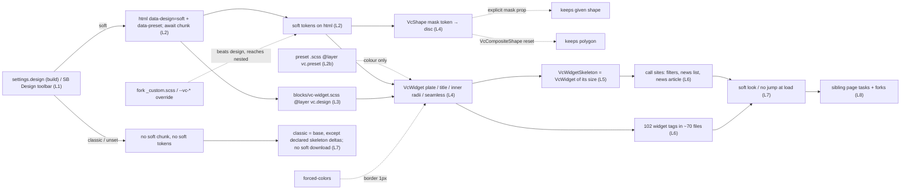
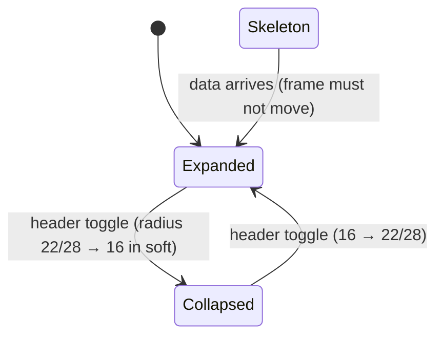

# TEST MODEL — VCST-6289

Ticket:      VCST-6289 | Type: Task | Status role: testable | Flow: feature-test | Priority: P1 (High) | Path: FULL | Changed: Frontend (vc-frontend theme only)
Shape class: ui-kit (ticket-routing.md §5c) — no Artifact-A authoring, no 3-cases, no C1 beyond 2a ids; carrier-first matrix (ui-kit-class.md §1)
Build:       vc-frontend#2620 @ b47e1167 (open, base dev 37cdaf67) — deployed on vcst as theme 2.62.0-pr-2620-b47e (classic). Soft surface = hosted QA Storybook (PR build, rebuilt 2026-11-06 09:44 UTC); BASE = hosted DEV Storybook (dev, 07:32 UTC: no Seamless story, expansion panels not deprecated)
Context:     FULL: ba-system-analyzer (1c) + ba-story-writer Mode B (1d) + 1r REACHABLE (1.5 min)
Prior model: reports/tickets/Sprint26-22/VCST-6232/vcst/test-model.md — Part 0 (chain L1–L8, carriers K1–K13) carried forward; DRIFT: soft now also sets --vc-widget-* (7 tokens), --vc-shape-mask-image and blocks/vc-widget.scss; html data-preset is written again (KB-5D6746FB superseded on this build)
Domain map:  ABSENT — no .claude/knowledge/domain file for the design system; single-layer chain ⇒ no 1c-map build; recommend /qa-domain-map design-system
Mind map:    ABSENT
Chain position: unverified — no domain map. Inside the design-system chain this ticket TOUCHES: design tokens for VcWidget/VcShape (L2), soft block rules (L3), VcWidget/VcShape/VcWidgetSkeleton render (L4–L5), 3 skeleton call sites (L6), preset stylesheet layer (L2b). It does NOT touch: the design switch itself (VCST-6231, Done), scale/typography role tokens (VCST-6232, Done), VcTable/VcPagination soft (VCST-6291/6292), headings scale (VCST-6290), any GraphQL/xAPI, any page layout outside skeleton call sites
Affected surface: vc-frontend storefront theme — ui-kit/components/organisms/widget/vc-widget.vue · widget-skeleton/vc-widget-skeleton.vue · molecules/shape/vc-shape.vue · composite-shape/vc-composite-shape.vue · expansion-panel(s) (deprecated) · designs/soft/{_tokens.scss,blocks/vc-widget.scss,index.scss} · assets/presets/paprika.{json,dark.json,scss} · core/utilities/design/index.ts · app-runner.ts · news-articles.vue · news-article.vue · products-filters.vue · image-gallery.vue + payment.vue · order-payment.vue · select-payment-method-modal.vue (VCST-6529). App reach (1c, approx.): 102 <VcWidget> in 70 files (lg 56, md 35, sm 5, xs 6; 24 prepend-icon; 0 seamless), 6 <VcWidgetSkeleton>, VcShape in product-titled-block, 4 VcCompositeShape on home. Map MISSING all (no map)
Ticket signals: no comments, no attachments. PR body: soft values "from the design as of 2026-09-25", known gaps for the designer (lg disc 40 vs 36, <md edge 6px vs 12–24, md one-line widget reads as pill ≥lg, soft dark = soft geometry + classic dark colours); classic skeleton changes on purpose; Known follow-ups: content past soft corners (tables, compare, news image…); VcExpansionPanel(s) deprecated; carries VCST-6529
Epic context: VCST-6135 Paprika Next Theme (In progress). Done seams: VCST-6231 (design switch, cascade layers), VCST-6232 (shape/typography tokens). Blocked by this: VCST-6291, 6292, 6233, 6290. Related: VCST-6634 (bulk results off expansion panels), VCST-6633 (filter/news cards own placeholders)
Domains:     storefront design system / ui-kit (no repo domain slug) · BL domain `ui`
Flows & boundaries: build setting → design chunk → tokens on html → block rules (vc.design) → component render → skeleton = widget → app call sites; Storybook toolbar (design/themePreset/darkMode globals); preset stylesheet layer vc.preset; fork _custom.scss (unlayered) and --vc-* overrides; print layer; forced-colors
Risk areas:  VC-UI-001 (only Coffee+Red gated) · VC-UI-004 (state-dependent layout: collapsed 28↔16 radius) · VC-UI-005 (BL-UI-001..006, SUSPECT) · VC-UI-006 (long value in flex cell → long widget title) · VCST-6232 B-1/B-2 uneven radius (literal 3–6px children inside now 22/28px plates) · transient skeletons unobservable without request delay (VCST-6232 C-15 BLOCKED)
AC traceability: 7 story ACs + 10 scope clauses → 45 atomic conditions T-01..T-45 (1d seed: scratchpad 1d-seed.md). Static: AC-1 CONTRADICTS (skeleton) · AC-2 SATISFIED md/lg, DRIFT xs/sm/collapsed/inset/corners · disc CONTRADICTS "opt-in" · nested = `seamless` prop (DRIFT) · AC-3 SATISFIED frame / DRIFT content · AC-4 SATISFIED · AC-5 NOT-FOUND · AC-6 SATISFIED · AC-7 CONTRADICTS (3 VCST-6529 files)
DoD: none declared — derived (1d §6): designer approval · Open Questions answered · BEM · release notes/fork impact · parity evidence · preset×mode matrix — each confirm-at-5-verdict

--- Part 0 — VALUE CHAIN ---
Value chain:
  L1 a store owner builds the theme with settings.design = soft (classic when unset); in Storybook the Design toolbar (globals design) switches at runtime
  L2 app start writes <html data-design> and <html data-preset>, awaits the design chunk; soft sets on html: --vc-widget-radius 22px (28 ≥lg), --vc-widget-border-width 0px, --vc-widget-shadow (two layers, preset additional-950 @5%/6%), --vc-widget-padding-x 24px (32 ≥lg), title 600/none/-0.02em, --vc-shape-mask-image circle, --design-widget-* copies; forced-colors ⇒ border 1px
  L2b a preset may ship <name>.scss in @layer vc.preset (paprika: cream plate light, additional-50 plate + neutral-300 divider dark), loaded only when that preset is active
  L3 blocks/vc-widget.scss (@layer vc.design): nested widget re-reads html tokens; xs/sm keep classic inset; xs/sm/collapsed/header-only/footer-only take --vc-radius 16px; --no-shadow ⇒ 1px border; lg widget's own title 16px
  L4 VcWidget renders: plate (border/bg/shadow/radius), header+footer inner corners = radius − border, body corner only when a design sets the radius, title via --vc-widget-title-* → --vc-heading-* → classic 700/uppercase; prepend-icon = VcShape (mask token ⇒ disc in soft, polygon in classic; explicit mask wins; VcCompositeShape resets); `seamless` ⇒ no plate, no inline padding, header + vertical spacing stay, <md stays inside VcContainer padding
  L5 VcWidgetSkeleton renders a VcWidget of its size (drops title/icons/toggle) ⇒ same radius, insets, header height, footer height as the loaded widget, in every design
  L6 app call sites: products-filters (collapsed vertical skeletons in the facets wrapper), news list (9 md skeletons, no head), news article (skeleton inside container padding <md), + every other widget page
  L7 the shopper sees: soft plates/title/disc; classic exactly as before except the declared skeleton deltas; no jump when content replaces a skeleton; classic downloads no soft CSS
  L8 what it unlocks: VCST-6291/6292/6233/6290 soft page tasks; forks restyle via 7 new --vc-* tokens + `seamless` without template edits

Chain diagrams:

Variants (the CARRIERS — union of what vc-widget.vue, blocks/vc-widget.scss, vc-shape.vue, the skeleton and the presets branch on; 1c §3):
  K1 top-level widget reading html tokens   K2 nested widget reading --design-widget-* copies   K3 size rules (xs/sm inset+radius, md, lg title)
  K4 state rules (collapsed, header-only/footer-only via :has, no-shadow ⇒ border, border=false)   K5 title token chain (widget → heading → classic)
  K6 VcShape mask token (default) vs explicit mask prop   K7 VcCompositeShape reset   K8 seamless   K9 forced-colors border   K10 skeleton-as-VcWidget
  K11 preset stylesheet (paprika, vc.preset)   K12 print layer   K13 fork override (unlayered / html token)   K14 app content painting to the plate edge
Orthogonal axes per cell: design {classic, soft} × preset {red, coffee gated; mercury, paprika ungated} × mode {light, dark} × viewport {375, 768–1023, ≥1024 lg} × surface {SB = hosted Storybook (both designs), SF = vcst storefront (classic only)}

Mechanism coverage matrix (scenario # · W = WAIVED + reason below · G = GAP):
| Carrier \ Link | L1 select | L2 tokens | L2b preset | L3 blocks | L4 render | L5 skeleton | L6 call site | L7 sees | L8 unlocks |
|---|---|---|---|---|---|---|---|---|---|
| K1 top-level | S1 | S4 | W1 | S4 | S4,S7 | S13 | S2 | S1,S2 | W2 |
| K2 nested | S1 | W10 | W1 | W10 | W10 | W3 | W4 | W10 | W2 |
| K3 size | S1 | S5 | W1 | S5 | S5,S7 | S13 | S22 | S5 | W2 |
| K4 state | S1 | S5 | W1 | S5,S6 | S6,S8 | S13 | S22 | S6 | W2 |
| K5 title | S1 | S7 | W1 | S7 | S7 | W3 | S2 | S7 | W2 |
| K6 mask | S1 | S9 | W1 | W5 | S9,S10 | W3 | S9 | S9 | W2 |
| K7 composite | S1 | S9 | W1 | W5 | S9 | W3 | S2 | S9 | W2 |
| K8 seamless | S1 | S11 | W1 | S11 | S11 | S13 | W4 | S11 | W2 |
| K9 forced-colors | S18 | S18 | W1 | S18 | S18 | S18 | W6 | S18 | W2 |
| K10 skeleton | S1 | S13 | W1 | S13 | S13 | S13 | S22,S23 | S22 | W2 |
| K11 preset sheet | S17 | S17 | S17 | W5 | S17 | W3 | W7 | S17 | W2 |
| K12 print | S27 | S27 | W1 | S27 | S27 | W3 | S27 | S27 | W2 |
| K13 fork | G1 | G1 | G1 | G1 | G1 | G1 | G1 | G1 | G1 |
| K14 edge content | S1 | S8 | W1 | S8 | S8 | W3 | W8 | S8 | W2 |
Waivers: W1 colour-only preset layer does not alter this carrier's geometry (K11 owns it) · W2 sibling tickets not built yet — unlock asserted only as tokens/prop existing (S4, S11) · W3 carrier has no skeleton counterpart (skeleton drops title/icon; nesting/preset colour inherit) · W4 0 app files use `seamless`/nesting (1c grep) — Storybook only · W5 no block rule targets this carrier · W6 soft-in-app waived by operator 2026-11-06 (design fixed at build time) · W7 paprika not active on vcst; switching the store preset is an operator-gated shared write (ui-kit-class §5) — Storybook only · W8 soft-in-app waived (operator) — PR's own follow-up list is carried as known
W10 (3x, 2026-11-06) no story nests a PLATED widget (only `seamless` children in the Seamless story) and the app has 0 nested widgets — K2 has no reachable carrier; S12 / T-18 / T-40 WAIVED with that evidence; recommend a nested-plate story to the author
GAP: G1 no fork build reachable; fork override claims (PR: a html[data-design=soft] override reaches nested widgets) are code-only → 3x may probe in Storybook by a read-only CSSOM check; else stays GAP
Page axis (clause 11b — config/storefront-pages.generated.json core tier, classic only; soft-in-app W6):
| Core page × auth | # | Core page × auth | # |
|---|---|---|---|
| /:pathMatch (home, anon/signed-in) | S2,S20,S24 | /cart (anon, signed-in) | S2,S20,S24 |
| /catalog (anon) | S2,S22 | /category/:id (anon) | S2,S22 |
| /product/:id (anon) | S2,S26 | /search (anon) | S2,S24 |
| /compare (anon) | S24 | /bulk-order (anon) | S25 |
| /account/dashboard (signed-in) | S2,S24 | /account/orders (signed-in) | S2,S24 |
| /account/orders/:orderId (signed-in) | S2,S28 | /account/profile (signed-in) | S24 |
| /account/addresses (signed-in) | S24 | /account/lists (signed-in) | S24 |
| /account/saved-for-later (signed-in) | S24 | /company/info (corporate) | S24 |
| /company/members (corporate) | S24 | /404, /sign-in, /sign-up, /forgot-password (anon) | S24 |
| /checkout/* shipping, billing, review (signed-in, setup) | W9 | /checkout/payment (signed-in, setup) | S28 / W9 |
W9 checkout steps need a filled cart + setup visit; widget parity there is covered by the Storybook PIXEL diff (S3); attempted for payment only because payment.vue is in the diff

Reverse edges (design state only; no money/stock):
  collapse ⇄ expand radius 22/28 ↔ 16 → S6 · soft → classic toggle restores classic tokens/polygon → S1 · skeleton → content swap must be a geometric no-op → S13, S22, S23 · fork override beats design → G1

Fixture lifecycle: no terminal state. Storefront rows read existing catalog/news/account data; signed-in rows use existing pooled accounts (@td user aliases resolved by the lane); image-gallery rows live-discover products with ≤4 and ≥5 images

--- Parts 1–5 — FAULT MODEL ---
Condition space: design(2) × preset(4: red, coffee gated · mercury, paprika ungated) × mode(2) × size(4) × state(8: plain, collapsed, header-only, footer-only, seamless, no-shadow, no-border, prepend-icon) × viewport(3) × surface(2) × nesting(2) = 24,576 raw. Constraints: soft ∉ SF (build-time + operator waiver) ⇒ 12,288; ungated presets informational (VC-UI-001) ⇒ only a negative-control cell each; seamless/nesting have 0 app consumers ⇒ SB only
Reduction: carrier-first (ui-kit-class §1) — the carrier is the only axis on which no value collapses; then pairwise (t=2) over design × preset × mode × viewport per carrier, exhaustive only for design × gated preset × mode (8 cells, AC-5). Dropped: size × state full product (subsumed by the block rules: size and state reach the plate only through K3/K4 selectors, so one row per selector suffices); preset × size (preset is colour-only: K11); surface × soft (waived). Classic geometry across ALL components is subsumed by one PIXEL diff (S3) instead of per-component rows. 24,576 → 29 (28 + the S3n control). The soft journey (S1) runs on Storybook because soft cannot reach the customer's surface (build-time design + operator waiver W6); S2 is the customer-surface journey for classic
Hypothesis oracles: every {HYPOTHESIS} value below is the PR's token value; it becomes {SPEC} only through the designer's export or the ticket owner's written answers to Open Questions 1–3 — until then a mismatch with the PR value is a FAIL, a match is "as implemented, not design-verified"
Test scenarios (29):
| # | Cell | Defect hypothesis | Archetype | Technique | Oracle | P |
|---|---|---|---|---|---|---|
| S1 | [JOURNEY] SB, red light, 1500px: Collapsible + PrependIcon + Seamless + skeleton WithWidget; Design classic→soft→classic | the toggle leaves stale tokens or the plate never changes, so soft ships invisible or classic is left soft after switching | state-leak | FLOW | {SPEC} AC-2/AC-4 wording + AC-1 restore | Critical |
| S2 | [JOURNEY-classic] SF anon + signed-in: home→catalog→product→cart→account dashboard/orders/order | the PR build's classic widgets differ from today (border, radius, shadow, uppercase 700 title, polygon icon) on real pages | regression-of-default | FLOW | {SPEC} AC-1 (base = DEV SB / PR-declared deltas) | Critical |
| S3 | [PIXEL] SB all stories, BASE dev SB vs HEAD QA SB, classic, red+coffee × light+dark, 1280+375 | an unintended classic change anywhere the kit is used (title font via font-heading, inner radius, VcShape mask from CSS) | silent-global-change | DIFF | {SPEC} AC-1; intended deltas only = skeleton (T-03) + story insets (PR) | Critical |
| S3n | [PIXEL negative control] same harness, HEAD classic vs HEAD soft | harness blind (reports 0 because nothing was compared) | false-green | DIFF | must report the plate/title/disc differences | High |
| S4 | SB soft md plate at 1023 and 1024px, red light | tokens not applied or lg step on the wrong breakpoint: border visible, square corners, inset off | token-not-wired | BVA | {SPEC} "no border, soft shadow, rounded corners"; values {HYPOTHESIS} PR tokens 0/22→28/24→32 — real oracle = designer export | High |
| S5 | SB soft xs, sm, collapsed, header-only, footer-only, header+footer-only, no-shadow | short plates render as pills; no-shadow plate loses its edge; xs/sm get the md inset | selector-scope | EP | {HYPOTHESIS} PR: radius 16, xs/sm classic inset, no-shadow 1px border | Medium |
| S6 | SB soft Collapsible: collapse ⇄ expand at lg | radius snaps 28↔16 and the header/neighbours move (VC-UI-004) | state-dependent-layout | ST | {BL-UI-003} no position change of neighbours; radius change itself {HYPOTHESIS} | Medium |
| S7 | SB title: soft md/lg + nested lg widget; classic same stories | soft title keeps capitals/700; lg 16px leaks into a nested widget title; classic title font changes through font-heading | cascade-leak | EP | {SPEC} "soft heading type, no capitals; classic keeps today's title"; 600/-0.02em/16px {HYPOTHESIS} PR | High |
| S8 | SB soft default-container-slot, header-container-slot, footer-container-slot, header-only | head/footer/padding-less body content paints past the rounded corners | clipping | EP | {SPEC} "head, footer and a body without padding follow the same corners" | Medium |
| S9 | SB soft PrependIcon, VcShape Basic/Mask, VcCompositeShape Basic; classic same | disc on every VcShape (ticket: opt-in only); explicit mask overridden; composite turns round; classic loses polygon | spec-impl-drift | DT | {SPEC} ticket "a block opts in; the others keep the plain icon" + "classic keeps the head icon" | High |
| S10 | SB soft lg widget prepend-icon, 1500px | disc size/centring off vs title (design 36 vs build 40, PR) | alignment | BVA | {BL-UI-005} centre ±1px; size {HYPOTHESIS} | Low |
| S11 | SB Seamless story, classic + soft, 1280 and 375 | seamless still draws border/shadow/radius/padding; its rows do not line up with the heading; <md it bleeds out of container padding | prop-not-wired | EP | {SPEC} "draws no box of its own, rows line up with its heading" | High |
| S12 | SB soft widget nested in a widget (container-slot stories) incl. inside xs/sm/no-shadow parents | nested widget inherits the parent's 16px radius / classic inset / 1px border instead of the html plate | cascade-leak | EP | {HYPOTHESIS} PR: nested re-reads html tokens; ticket says nothing | Medium |
| S13 | SB WithWidget, each size xs–lg, classic + soft, red light+dark | skeleton frame ≠ widget frame (radius, insets, header min-height, footer height) ⇒ jump when content arrives | layout-shift | EP | {SPEC} AC-3 + {BL-UI-003} | Critical |
| S14 | SB soft dark × red, coffee: plate bg, divider, title, disc icon | soft dark with classic dark colours yields title <4.5:1 or disc glyph <3:1 on its disc | contrast | EP | {BL-A11Y} WCAG 1.4.3/1.4.11 | High |
| S15 | SB AC-5 matrix: red, coffee × light, dark × classic, soft on Collapsible + PrependIcon + Seamless (8 cells) | a preset/mode combination drops a token (e.g. shadow colour from additional-950 unresolved in dark) | combination | PW | {SPEC} AC-5 + AC-2 wording | High |
| S16 | SB negative control: soft on an ungated preset (mercury) | harness grades everything PASS (false green) | false-green | EP | known: informational only (VC-UI-001) — must still be MEASURED | Medium |
| S17 | SB paprika light/dark, classic + soft; network: paprika.scss only when themePreset=paprika | preset stylesheet loads for every preset or not at all; cream plate missing | load-scope | DT | {HYPOTHESIS} PR (ungated, informational) | Low |
| S18 | SB forced-colors emulation, soft: plate, seamless, :border=false | forced-colors drops the shadow and the plate disappears (no edge) | a11y-mode | EP | {BL-A11Y} 1.4.11 non-text contrast; 1px border {HYPOTHESIS} PR | Medium |
| S19 | SB soft Collapsible keyboard: Tab to header, Enter/Space, focus ring | focus ring clipped by the rounded plate / overflow; aria-expanded missing | focus-clip | ST | {BL-A11Y} 2.4.7/4.1.2 | Medium |
| S20 | SF classic: network + CSSOM on home, catalog, cart | classic downloads the soft chunk or Inter/Geologica, or carries soft rules (AC-6) | load-scope | DT | {SPEC} AC-6 | High |
| S21 | static: every .vue in the PR diff has no Tailwind utility in its template | touched files left non-BEM (AC-7) | spec-violation | INSPECT | {SPEC} AC-7 | Medium |
| S22 | SF classic /catalog + /category/:id facets: filter skeleton vs loaded facets, 375 + 1280 | collapsed skeleton height ≠ facet height ⇒ column jumps when facets load | layout-shift | BVA | {BL-UI-001}/{BL-UI-003}; PR: both 40px | Medium |
| S23 | SF classic /news list + article: 9 md skeleton cards; article skeleton <md inside padding | wrong card count/width or article skeleton bleeds at 375 | layout-shift | EP | {BL-UI-003}; news rows growing on arrival = known (VCST-6633) | Low |
| S24 | SF classic core-page sweep BL-UI-001..006 at 375/1024/1280 (page axis) | a widget call site breaks layout in classic on the PR build (overflow, misalignment) | layout-invariant | SWEEP | {BL-UI-001..006} | Medium |
| S25 | SF /bulk-order → results modal (deprecated VcExpansionPanel(s)) | deprecated panels stop rendering or log in production | deprecation-break | FLOW | {SPEC} PR: still works, dev-only warning | Low |
| S26 | SF /product/:id image gallery, products with 4 and ≥5 images (VCST-6529) | thumbnail arrows shown with 4 images or hidden with 5 after the Swiper lock change | regression-of-default | BVA | {SPEC} PR VCST-6529 §5 | Medium |
| S27 | print emulation: SF classic product/cart widgets; SB soft Collapsible + PrependIcon | print shows soft shadow/disc, or classic print changed after two print rules were removed | print-layer | EP | {SPEC} PR VCST-6529 §3 (print layer wins; .vc-button hidden) | Low |
| S28 | SF classic order payment page + /checkout payment step: payment logos (VcImage object-center removed) | logos shift/crop after object-center removal | regression-of-default | EP | {SPEC} PR: object-center equals the default ⇒ no change | Low |
Probes carried in: VC-UI-001 → S15/S16 · VC-UI-004 → S6 · VC-UI-005 → S24, S13, S22 · VC-UI-006 → S7 (long title via Storybook Controls) · VC-UI-002 N/A (no mobile-menu change) · VC-UI-003 N/A (no VcTable change) · VC-UI-007 N/A (no strings changed)
Archetype sweep: regression-of-default S2/S3/S26/S28 · silent-global-change S3 · state-dependent-layout S6 · layout-shift S13/S22/S23 · cascade-leak S7/S12 · false-green S3n/S16 · contrast S14 · a11y-mode S18 · focus-clip S19 · load-scope S17/S20 · spec-impl-drift S9 · clipping S8 · data-dependent / concurrency / money archetypes WAIVED: no data or state is written by this change
UIP sweep (UI only): UIP-VIEW S4/S11/S24 · UIP-REFRESH S20 · UIP-BACK, UIP-DEEP, UIP-TABS, UIP-EXPIRE, UIP-STORAGE, UIP-INPUT, UIP-DATA WAIVED: a style-only change with no route, storage, session or input behaviour · UIP-NET S22/S23 attempted (skeletons only appear while requests are in flight; no request-delay tool in the lanes ⇒ likely NOT REACHED)
Business Rules: BL-UI-001, BL-UI-002 (S4 values on scale), BL-UI-003, BL-UI-004, BL-UI-005, BL-UI-006 (S19 header target ≥24×24 at 375), BL-A11Y (WCAG 1.4.3, 1.4.11, 2.4.7, 4.1.2); BL-UI-007 N/A (admin). Proposed (Oracle Feedback only): skeleton parity · design isolation · colour by value
Edge cases:  ECL-7.1 (narrow viewport) S11/S23 · ECL-7.3 (font/asset load) S20 · ECL-7.4 (collapsed navigation) S6 · ECL-14.10 N/A (admin)
Docs grounding: VirtoOZ StorefrontDeveloperGuide "Visual Theme Customization" (--vc-radius 0.5rem, per-component --vc-widget-radius, 10px recommended max — soft exceeds it: note for the author, not an oracle for NEW soft) · FrontendSourceCode pre-PR vc-widget/skeleton/shape. No doc covers design/soft/seamless/disc/preset stylesheets ⇒ NEW: ticket AC + PR + source + live are ground truth. kb: KB-7CAAD492, KB-9BCB34C7 (superseded for the widget), KB-261CE805 (method), KB-5D6746FB (conflicts: data-preset now written), kb_none on skeleton parity
vs. DESIGN: SKIPPED — no Claude Design prototype or design export linked on ticket, epic or PR (1c §8)
Agents to dispatch: 3x /qa-exploratory ticket (playwright-chrome) · 4a qa-frontend-expert (playwright-chrome: S2, S20, S22–S28) · 4v vc-test:ui-ux-expert (playwright-edge: S1, S3–S19 Storybook measurement + PIXEL + a11y) · A/2a test-management-specialist (browserless: 180 tc:scope hits) · S21 inline (static grep at PR head)

## Round 1 — 3x amendments (discovery lane, 2026-11-06, SBTM-VCST-6289-2026-11-06.md)
- L3 corrected: **header+footer-only takes the full plate radius (28 ≥lg)**; only header-only, footer-only, collapsed, xs, sm take 16. S5's expected values split accordingly.
- L4 title scale per size observed: xs 14 · sm 16 · md 18 · **lg 16** (the lg 16px rule makes lg smaller than md) — {HYPOTHESIS} until the designer answers; not a FAIL on its own.
- L2b / S17: Storybook bundles every preset into one stylesheet, so "the preset sheet loads only for its preset" is unobservable there and the app half is W7 ⇒ S17 network half WAIVED; CSS half (rules scoped by `data-preset`) observed.
- K2 / S12 / T-18 / T-40: no carrier (W10).
- Reverse edge collapse ⇄ expand confirmed: radius 28↔16, 0px movement of header/title/plate top, no transition (S6 grounded).
- {HYPOTHESIS} → {OBSERVED} (soft, red, light): S4 border 0, radius 22/28 at 1023/1024, two-layer shadow 5%/6%, inset 24/32 · S5 xs/sm 16/16, collapsed 16 + inset 32, no-shadow 28 + 1px border · S7 Geologica 600 none -0.02em; classic Lato 700 uppercase identical QA vs DEV · S10 lg disc 40px, centres 0px off at every size · S18 forced-colors 1px border, seamless/:border=false 0.
- Net-new scenarios (PROMOTE, into the checklist — this class authors no cases):
| # | Cell | Defect hypothesis | Archetype | Technique | Oracle | P |
|---|---|---|---|---|---|---|
| S29 | SB soft dark × red, coffee, paprika, mercury: plate bg vs page bg, border, shadow alpha | the plate has no visible edge in dark (bg = page, border 0, 5–6% glow), so blocks merge into the page | contrast | EP | {BL-A11Y} WCAG 1.4.11 non-text contrast of the plate boundary — {HYPOTHESIS} whether a plate edge is a required "UI component boundary"; real oracle = designer | Medium |
| S30 | SB + SF collapsible header (classic + soft): aria-expanded / aria-controls | screen-reader users cannot tell a widget is collapsed (pre-existing on DEV) | a11y-name-role-value | ST | {BL-A11Y} WCAG 4.1.2 | Medium |
| S31 | SB soft body-only md plate ≥lg (no-shadow story) | a short body-only plate becomes a pill (height 58 ≤ 2×28) | selector-scope | BVA | PR known gap — {HYPOTHESIS}, designer | Low |
- Net-new DECLINED: title size order xs<sm≤md vs lg (needs designer) · VcStatWidget soft parity (sibling task, out of scope).
- Existing-case evidence for 2a (source 5): 002 CAT-011 holds (4 images ⇒ arrows locked) · **048c LAYOUT-COMP-VCEXPANSION-001/-004 STALE** — /catalog has 0 `.vc-expansion-panel(s)`; facets are xs collapsible VcWidgets (pass on nothing today) · 077 CPN-051 holds (page's own placeholder, not VcWidgetSkeleton — precondition wording off) · 093 SR-HD-034 NOT REACHED.
- Gate re-derived after the amendment: matrix still has no blank cell (K2 → W10); S5 expected values corrected; new rows S29–S31 carry all five fields. 29 → 32 rows.
