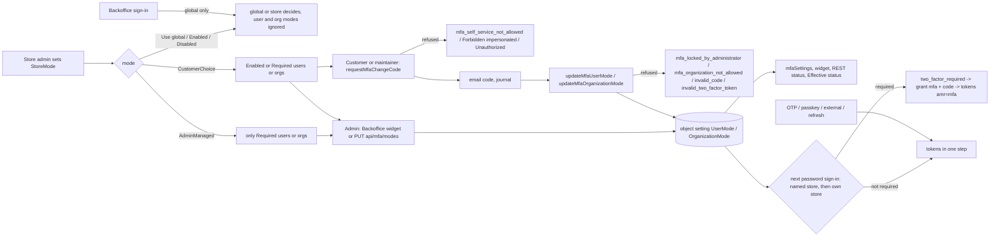
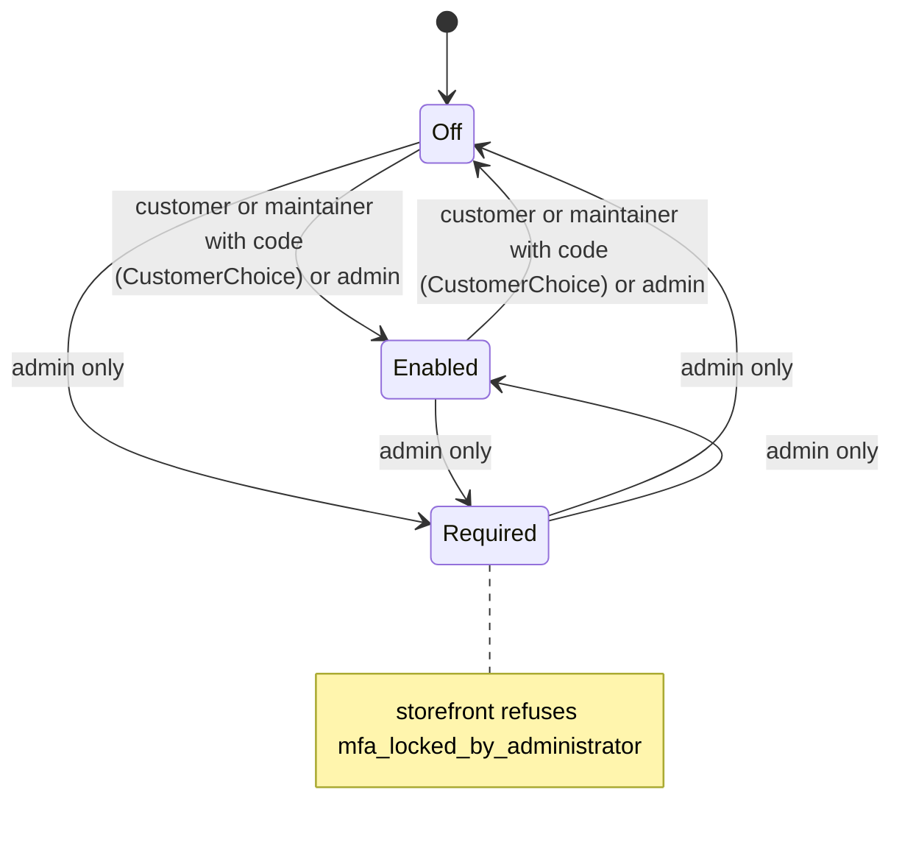

# TEST MODEL — VCST-6597

Ticket: VCST-6597 | Type: Story | Status role: testable (Testing) | Flow: feature-test | Priority: P2 (Medium) | Path: FULL | Changed: Both (module backend + AngularJS admin + Admin Shell + xAPI + storefront)
Context: FULL — 1c ba-system-analyzer · 1d ba-story-writer (Mode B) · 1r REACHABLE (~2 min)
Prior model: none for this ticket. Part 0 is carried forward from `.claude/knowledge/domain/auth.md` rev 4 §1 links 10–13 (the 6597 chain, written 2026-11-04). The changes against it are recorded as drift below.
Domain map: .claude/knowledge/domain/auth.md @ rev 4 (generated 2026-11-04) — PRESENT
Mind map: .claude/knowledge/domain/auth.mind-map.json — nodes auth.signin.mfa.store-mode.{admin-managed,customer-choice,disabled-own-customers,modes-ignored} · auth.signin.mfa.own-store · auth.signin.mfa.organization-mode · auth.mfa-mode.{customer-change,organization-change,self-service-not-allowed,locked-by-administrator,organization-not-allowed,organization-required-member,change-ticket-purpose,wrong-change-code,confirmed-email-needed,impersonated-refused,admin-set,admin-read-only,status-preview,widget-gate,read,admin-view} · auth.state.mfa-mode.{off,enabled,required}
Mind-map DRIFT: (1) no node for "change code inside the resend window issues a ticket without email" (H-d); (2) no node for the cross-store change (a customer of store A changes the mode via a CustomerChoice store B); (3) `requestMfaChangeCode` refuses outside CustomerChoice before sending (MfaSelfService L88) — the map's D-row says it does not check, so the map is stale on this point.
Chain position: links L10–L13 of the auth chain L1–L13 (who is asked → turning it on → admin decides → it bites at the next password sign-in), plus the L2 challenge leg (`two_factor_required` → `grant_type=mfa`) as the observation surface. It does NOT touch L1 method choice, L3 org resolution (only the fallback seam via the `mfa` grant), L4 session storage, L6 impersonation flow itself (only the refusal of a change), L7 sign-out/terminate, L8–L9 passkey/sign-in-method management.
Affected surface (all in auth.md §2 unless marked MISSING): store setting `MultiFactorAuthentication.StoreMode` (Store Settings › Security) · AngularJS user-blade and organization-blade MFA widget + Mode blade + Effective status · Admin Shell user overflow "MFA: …" + mode page · REST `api/mfa/modes/{users|organizations}/{id}[/status][?mode=]` · xAPI `mfaSettings`, `requestMfaChangeCode`, `updateMfaUserMode`, `updateMfaOrganizationMode` · storefront Account › Security and Company › Info MFA widget · token endpoint `password`/`mfa` grants · notification journal (`MfaSignInEmailNotification`). MISSING from the map: the Admin Shell has no route to an organization (no Customers/Organizations nav, live 1c), the change email reuses the sign-in template, the limiter is shared between sign-in and change codes, and the org status endpoint is not user-specific.
Ticket signals: comment 112561 = the dev's 14 scenarios; scenario 10 (`mfa:read` real role) is only partly done, "QA: please verify with a real role" · comment 112608 = VCST-6495 folded in (own store applies; the "Known limitation" in the description is obsolete) + a known gap (Backoffice status ignores own store; 1d reads it as closed in code) · comment 112620 = VCST-6530 folded in (Disabled skips only the own non-Backoffice customers; new status fields isRequiredByUserStore / isDisabledModeSkipped / userStoreId) · attachments 1–7 = the reference UI states for store setting, Backoffice org/user blades, Company › Info, the change-code step, the member "required by company" state and the sign-in code step; the mp4 is not opened (video, gap) · linked bugs VCST-6686 (Medium), VCST-6687 (Low), VCST-6688 (Low), filed by an earlier agent session today, status Draft.
Epic context: none (no parent Epic). Siblings by link: VCST-5904 (MFA by email, released, the baseline), VCST-6495 and VCST-6530 (On hold, their code ships in this PR), VCST-6533 (related).
Domains: auth (security) · b2b organization (members, org roles)
Flows & boundaries: password grant ↔ mfa grant · org fallback on the `mfa` grant (BL-AUTH-015/016) · OTP / passkey / external / refresh (never challenged) · impersonation (Login on behalf) · shared lockout counter (BL-AUTH-003) · notification journal (no SMTP on vcst)
Risk areas: VC-AUTH-004 (rule enforced on one surface only: VCST-6687, status vs sign-in) · VC-AUTH-006 (an exemption keyed to a heuristic: the Backoffice classification, VCST-6686) · VC-AUTH-005 (Admin Shell 401 handling, cookie-only fetch)
AC traceability: 21 story ACs (AC-1..21, description + comments) + 25 gap-ACs from 1d. The conditions this model carries forward are mapped in the scenario table. DRIFT: AC-1, AC-5, AC-9, AC-10, 15.c. CONTRADICTS: AC-17 (description vs code; the code follows the comment).
DoD: none declared. Implicit items to confirm at 5-verdict: e2e/live run, localization quality, a11y, console, real-role check of scenario 10, security review. A release note for the Disabled change is NOT in the PRs.

## Part 0 — VALUE CHAIN

Value chain:
- V1 The store administrator chooses who decides: StoreMode = Use global / Enabled / Disabled / AdminManaged / CustomerChoice.
- V2a The administrator sets a user or a company to Off / Enabled / Required (Backoffice widget or REST, `mfa:manage`, no code).
- V2b In a CustomerChoice store, a customer (Account › Security) or a company maintainer (Company › Info, `xapi:my_organization:mfa:manage`) asks for a change code: `requestMfaChangeCode`.
- V3 The code arrives by email (notification journal on vcst), async hop 1.
- V4 The customer confirms the change with the token and the code: `updateMfaUserMode` / `updateMfaOrganizationMode`.
- V5 The mode is stored as an object setting on the user or organization. No session is revoked and nothing is logged.
- V6 The surfaces re-read it: `mfaSettings`, the storefront widget, REST status and the Backoffice Effective status.
- V7 At the NEXT password sign-in (async hop 2), MfaRequirementService decides for the named store, then the user's own store: org modes first, then the user mode.
- V8 The customer gets `two_factor_required`, enters the emailed code at `grant_type=mfa`, and is signed in (`amr=mfa`). What this protects: an account whose password leaked.



```mermaid
sequenceDiagram
  participant U as Customer / maintainer
  participant X as xAPI mfa
  participant S as MfaSelfService + MfaService
  participant J as Notification journal
  participant M as Object settings
  participant P as Token endpoint
  U->>X: requestMfaChangeCode(storeId)
  X->>S: CustomerChoice? not impersonated?
  S->>J: code (ticket purpose=Change); inside 30 s resend window: ticket, no new email (H-d)
  U->>X: update*Mode(enabled, token, code)
  X->>S: owner + purpose + code; canChange (ignores org req: VCST-6687)
  S->>M: mode
  Note over U,P: hop 2 - nothing changes for live sessions
  U->>P: grant_type=password (store named / none / other)
  P-->>U: 400 two_factor_required + twoFactorToken
  U->>P: grant_type=mfa + code
  P-->>U: tokens amr=mfa
```



Variants (union of the layers that branch: MfaRequirementService, MfaSelfService/MfaUserResolver, MfaModesController, the widget):
- VA store mode: Use global · Enabled · Disabled · AdminManaged · CustomerChoice
- VB who changes the mode: customer (xAPI) · maintainer (xAPI + permission + current org) · administrator (REST/Backoffice) · impersonated operator · admin with `mfa:read` only
- VC user kind for the requirement: role-less customer · customer with an org role carrying permissions · Manager/Administrator · store-less user · multi-org contact
- VD request names: own store · none · another store · unknown store
- VE entry point: password grant · Backoffice sign-in · OTP/passkey/external/refresh
- VF account state: confirmed email · unconfirmed email
- VG admin UI: AngularJS · Admin Shell

Mechanism coverage matrix (rows = variants, cols = links V1–V8; cell = scenario # | GAP | WAIVED + reason; "—" = the variant does not cross this link by construction, stated as WAIVED-n/a):

| Variant | V1 | V2a | V2b | V3 | V4 | V5 | V6 | V7 | V8 |
|---|---|---|---|---|---|---|---|---|---|
| VA Use global | 13 | 13 | 8 | WAIVED-n/a | WAIVED-n/a | 13 | 13 | 13 | 13 |
| VA Enabled | 11 | 13 | 8 | WAIVED-n/a | WAIVED-n/a | 13 | 28 | 11 | 11 |
| VA Disabled | 12 | 13 | 8 | WAIVED-n/a | WAIVED-n/a | 13 | 17 | 12 | 12 |
| VA AdminManaged | 3 | 3 | 3 | WAIVED-n/a (refused before send) | 3 | 3 | 3 | 3 | 3 |
| VA CustomerChoice | 1 | 4 | 1 | 1 | 1 | 1 | 1 | 1 | 1 |
| VB customer | WAIVED-n/a | WAIVED-n/a | 1 | 1 | 1 | 1 | 1 | 1 | 1 |
| VB maintainer | WAIVED-n/a | WAIVED-n/a | 2 | 2 | 2 | 2 | 2 | 2 | 2 |
| VB administrator | 1 | 14 | WAIVED-n/a | WAIVED-n/a | WAIVED-n/a | 14 | 14 | 14 | 14 |
| VB impersonated | WAIVED-n/a | WAIVED-n/a | 10 | WAIVED-n/a | 10 | 10 | 10 | WAIVED-n/a | WAIVED-n/a |
| VB admin mfa:read | WAIVED-n/a | 15 | WAIVED-n/a | WAIVED-n/a | WAIVED-n/a | 15 | 15 | WAIVED-n/a | WAIVED-n/a |
| VC role-less customer | WAIVED-n/a | 3 | 1 | 1 | 1 | 1 | 1 | 12 | 12 |
| VC org-role customer | WAIVED-n/a | WAIVED-n/a | 2 | 2 | 6 | 2 | 17 | 12 | 12 |
| VC Manager/Admin | WAIVED-n/a | WAIVED-n/a | WAIVED-n/a | WAIVED-n/a | WAIVED-n/a | WAIVED-n/a | 17 | 12 | 26 |
| VC store-less user | WAIVED-n/a | WAIVED-n/a | WAIVED-n/a | WAIVED-n/a | WAIVED-n/a | WAIVED-n/a | GAP (map: no stand-less status row) | 11 | 11 |
| VC multi-org contact | WAIVED-n/a | WAIVED-n/a | 22 | 22 | 22 | 22 | 22 | 22 | 22 |
| VD own / none / other / unknown | WAIVED-n/a | WAIVED-n/a | 21 | 21 | 21 | WAIVED-n/a | 17 | 11 | 11 |
| VE password grant | WAIVED-n/a | WAIVED-n/a | WAIVED-n/a | WAIVED-n/a | WAIVED-n/a | WAIVED-n/a | WAIVED-n/a | 1 | 1 |
| VE Backoffice sign-in | WAIVED-n/a | WAIVED-n/a | WAIVED-n/a | WAIVED-n/a | WAIVED-n/a | WAIVED-n/a | WAIVED-n/a | 26 | 26 |
| VE OTP/passkey | WAIVED-n/a | WAIVED-n/a | WAIVED-n/a | WAIVED-n/a | WAIVED-n/a | WAIVED-n/a | WAIVED-n/a | 25 | 25 |
| VF unconfirmed email | WAIVED-n/a | WAIVED-n/a | 9 | 9 | 9 | 9 | 9 | 19 | 19 |
| VG AngularJS | 1 | 14 | WAIVED-n/a | WAIVED-n/a | WAIVED-n/a | 14 | 14 | WAIVED-n/a | WAIVED-n/a |
| VG Admin Shell | GAP (setting edited in AngularJS only) | 18 | WAIVED-n/a | WAIVED-n/a | WAIVED-n/a | 18 | 18 | WAIVED-n/a | WAIVED-n/a |

Reverse edges (a forward effect that moves an entitlement, here the right to sign in without a code):
- User Enabled → Off by the customer, with a code → #1 (second half).
- Org Enabled → Off by the maintainer: members whose own mode is Enabled are still asked → #2.
- Required → lowered: only by the administrator → #4 (storefront refused), #14 (admin lowers it).
- Store leaves CustomerChoice/AdminManaged: the stored modes go dormant and bite again when the store returns → #23.
- Requirement switched ON while a member is signed in: the live session is not ended → #24. **ABSENT IN PRODUCT (D33), a finding to report.**
- A mode change leaves no audit or notification → **ABSENT IN PRODUCT (D32)**. Recorded by #24, not asserted as a defect (no AC asks for it).
- User/org deleted → the object setting stays: UNVERIFIED, WAIVED (needs deletes on shared data; H-e covers the orphan write path, #16).

Fixture lifecycle: every scenario runs on a per-run disposable MFA store and accounts (`scripts/seed-data/auth/mfa-fixtures.mjs`, `createMfaStore` / `createMfaAccount`) and tears them down. A mode is TERMINAL-ish per account: once Required is set, the storefront cannot reset it, so each case creates its own account. A change ticket is single-use. Nothing uses shared B2B-store (currently Disabled, point-in-time) or the global switch. The exceptions are #12 and #26, whose sign-in half needs global MFA on and so runs only inside the scope regression's exclusive window (110a / 110).

## Part 0r — ROLE SCENARIOS (the matrix carries 6 role variants)

Roles in scope → creator kinds (`mfa-fixtures-specs.mjs` KINDS; created per run, no shared alias):
- customer → `customer-confirmed` · unconfirmed customer → `customer-unconfirmed`
- maintainer → `org-mfa-maintainer` (run role OrgMfa = `xapi:my_organization:mfa:manage`)
- member → `org-mfa-member`
- operator → `imp-operator-run-store` + `imp-target-run-store`
- admin with `mfa:manage` → `manager-mfa-manage`
- admin with `mfa:read` only → `manager-mfa-read`
- org-role customer → `customer-permission-role`
- multi-org contact on the run store → **FIXTURE-GAP**: `b2b-two-org` is bound to B2B-store, not the run's MFA store. Routed to 3a as a top-up, or the case moves the store via `setContactOrganization` and the account's store at run time.
- Precondition for every role case: verify the role→permission binding from `me.permissions` or the token at run time; never assert it against the fixture file. Every actor is asserted to be a non-administrator.

BSC-1 — A customer protects their own account
  Role: customer · Situation: the store lets customers choose (CustomerChoice)
  | # | Action | Sees | Can do | Expected |
  | 1 | opens Account › Security | status Off, Turn on | request a code | code emailed {SPEC} |
  | 2 | enters the code | status On | Turn off | next sign-in asks for the code {BL-AUTH-022} |
  Outcome: a leaked password alone no longer opens the account.
  Not allowed: change without a code; change with another user's or a sign-in ticket; change in an AdminManaged/Enabled store (`mfa_self_service_not_allowed`, no email); lower a Required mode (`mfa_locked_by_administrator`).

BSC-2 — A company maintainer requires MFA for the whole company
  Role: maintainer (+ member) · Situation: CustomerChoice store, B2B company
  | # | Action | Sees | Can do | Expected |
  | 1 | maintainer opens Company › Info | company MFA Off | Turn on with code | org mode Enabled {SPEC} |
  | 2 | member signs in | code step | enter code | signed in; Account › Security says the company requires it, no switch {BL-AUTH-021} |
  Outcome: every buyer holding contract pricing is protected.
  Not allowed: a member without the permission changes the company (`mfa_organization_not_allowed`); a maintainer changes another org; a member switches themselves off while the org requires it (server must refuse: VCST-6687 open); a Required org is lowered from the storefront.

BSC-3 — The administrator decides for a user and a company
  Role: admin `mfa:manage` · read-only admin `mfa:read` · Situation: AdminManaged store
  | # | Action | Sees | Can do | Expected |
  | 1 | sets the user to Required on the user blade, Save | Effective status per store | Preview without saving | the user is asked at the next sign-in {BL-AUTH-023} |
  | 2 | read-only admin opens the same blade | mode and status | nothing | Mode select locked, no Save; PUT → 403 {SPEC 112561 #10} |
  Outcome: the administrator enforces MFA on accounts that matter.
  Not allowed: `mfa:read` writes (UI and REST 403); the customer lowers Required from the storefront; anonymous REST (401).

BSC-4 — An operator acting on behalf cannot change MFA
  Role: operator (Login on behalf) · Situation: CustomerChoice store, same company
  | # | Action | Sees | Can do | Expected |
  | 1 | impersonates the target, opens Account › Security | target status, no switch | nothing | `requestMfaChangeCode` and update mutations → Forbidden; the mode is unchanged {BL-AUTH-024} |
  Outcome: a support session cannot weaken a customer's protection.
  Not allowed: any MFA change in an impersonated token (user or org).

## Parts 1–5 — FAULT MODEL

Condition space (raw): VA 5 × user mode 3 × org mode 3 × VC 5 × VD 4 × VB 5 × VE 3 × VF 2 × VG 2 → N = 5·3·3·5·4·5·3·2·2 = 54,000. Constraints:
- user/org mode are read only in AdminManaged/CustomerChoice;
- the storefront changes only in CustomerChoice;
- Required is set by the admin only;
- the Backoffice sign-in ignores VA/VC/VD;
- OTP/passkey ignore everything;
- VG matters only for V2a/V6.
Feasible ≈ 1,900.

Reduction: N = 54,000 → feasible ≈ 1,900 → M = 30.
- **DT over requirement:** VA × user mode × org mode collapse to the 8 rows of the requirement table (auth.md §1). That table is the specification; each row is one decision → #3, #5, #11, #12, #13, plus the customer-choice rows.
- **Dropped:**
  - VD collapses to own-vs-other. The "none" and "unknown" store requests share one code path with "other" (L58–67) and are covered as one case, #11.
  - VG is reduced to "the AngularJS blade drives, the Admin Shell is spot-checked": the transport and the route differ, the rule does not.
  - VE OTP/passkey is one row: one code path, `IsTwoFactorRequiredAsync` = false.
  - VF unconfirmed is tested on the change path (#9) and the org-enable path (#19), not × every store mode (the guard is in ChallengeAsync, store-independent).
  - VB × VA beyond CustomerChoice/AdminManaged is pruned: the xAPI is refused before anything mode-specific (#8).
- **Pairwise (t=2):** used across VB × VC for the refusal set (Part 0r Not-allowed lines). t=3 is not used: no revenue link.

Test scenarios (M = 30):
| # | Cell | Defect hypothesis | Archetype | Technique | Oracle | P | Corpus |
|---|---|---|---|---|---|---|---|
| 1 | CustomerChoice · customer · own store · storefront | [JOURNEY] Turn on with the emailed code → next sign-in asks → Turn off with code → one step again; a switch that confirms but does not change the next sign-in, or cannot be undone | SILENT | FLOW | {BL-AUTH-022} {SPEC AC-3/7} | Critical | MFASF-015, MFA-047 |
| 2 | CustomerChoice · maintainer + member | the company switch does not reach members, the member keeps a personal switch, or Off by the maintainer drops a member's own Enabled | SCOPE | FLOW | {BL-AUTH-021} | Critical | MFASF-018, MFA-050 |
| 3 | AdminManaged · Off/Enabled/Required | Enabled wrongly requires the code, Required does not; the storefront offers a switch the server refuses; a code is mailed for a refused request | PARITY | DT | {SPEC AC-2} {BL-AUTH-023} | High | MFA-038, MFASF-016, MFA-048 |
| 4 | CustomerChoice · user Required (admin) | the storefront offers a switch or the mutation lowers Required; a code mailed for a request that can never succeed (README says refused) | SCOPE | DT | {BL-AUTH-023} {SPEC README} | High | MFA-049, MFASF-017 (VCST-6688) |
| 5 | CustomerChoice · org Required · member own Off | a member's Off outranks the org; the server accepts a member's switch it hides (VCST-6687, SPEC kept) | SCOPE | DT | {BL-AUTH-021} | High | MFA-040, MFA-052 |
| 6 | CustomerChoice · member without permission / maintainer of org B | a member changes the company, or a maintainer changes another org | SCOPE | DT | {SPEC AC-10} {BL-AUTH-021} | High | MFA-051 |
| 7 | change ticket ↔ sign-in ticket ↔ another user's ticket | a change ticket signs in, or a sign-in ticket confirms a change | SCOPE | DT | {BL-AUTH-022} | Critical | MFA-053 |
| 8 | non-CustomerChoice · customer · request | a code is mailed and the mode changed outside a self-service store | SILENT | EP | {BL-AUTH-022} | High | MFA-048 |
| 9 | CustomerChoice · unconfirmed email · Turn on / Turn off | Turn on enabled with no way to get a code; Turn off offered but cannot complete (H-b) | FALLBACK | EP | {SPEC AC-9} | Medium | MFA-055, MFASF-019; Turn-off half NEW |
| 10 | CustomerChoice · impersonated | an operator token changes the target's MFA, or the UI shows a switch | SCOPE | DT | {BL-AUTH-024} | High | MFA-056; UI half NEW |
| 11 | own store Enabled · request none/other/unknown | omitting storeId or naming another store skips the code (VCST-6495) | SCOPE | EP | {BL-AUTH-020} | High | MFA-036, MFA-037 |
| 12 | Disabled · role-less / org-role / Manager · global on | an own role-less customer is asked; a Manager or other-store user skips; an org-role buyer is treated as Backoffice (VCST-6686) | SCOPE | DT | {BL-AUTH-019} | High | MFA-033/034/035/062 — global window, scope regression |
| 13 | Use global/Enabled/Disabled · user Required | a user/org mode leaks into a store mode that must ignore it | PARITY | DT | {SPEC AC-1} | Medium | MFA-041 |
| 14 | Backoffice AngularJS · user + org Required · preview | Save does not persist; the org widget missing; preview writes; status disagrees with the setting | STALE | ST | {SPEC AC-12} | High | MFA-057, MFA-058, MFA-060 |
| 15 | real role `mfa:read` only | a read-only admin can change the mode (UI enabled or PUT 200) | SCOPE | DT | {SPEC 112561 #10} | High | MFA-043, MFA-059 |
| 16 | REST unknown mode / unknown id / anonymous | 500 instead of 400/401; a PUT on an unknown id writes an orphan setting (H-e) | BOUNDARY | BVA | {SPEC 112561 #12} {HYPOTHESIS H-e → SPEC needed from author} | Medium | MFA-042, MFA-044; orphan NEW |
| 17 | status API / Effective status vs real sign-in | the admin status says "not required" for a store where the sign-in asks (112608 known gap; 1d reads it as closed) | PARITY | CT | {SPEC 112620} | High | MFA-045 |
| 18 | Admin Shell user page | the Admin Shell mode change is not stored, or the page 401s on a token session | PARITY | EP | {SPEC 112620 "checked … Admin Shell"} | Medium | MFA-061 |
| 19 | CustomerChoice · maintainer turns org on · member unconfirmed | the member is locked out with no warning to the maintainer (H-a) | FALLBACK | EG | {HYPOTHESIS H-a → needs PO decision} | Medium | NEW |
| 20 | change request inside the 30 s resend window | a ticket is issued but no email is sent, and the customer waits for a code that never comes (H-d) | SILENT | EG | {SPEC AC-7} | Medium | NEW |
| 21 | customer of store A · change via CustomerChoice store B | a customer changes their global user mode through a store that is not theirs (gap-AC-10) | SCOPE | EG | {HYPOTHESIS → author question} | Medium | NEW |
| 22 | multi-org contact · org B Required · current org A | the requirement comes from an org that is not current, and the widget does not say which (gap-AC-11) | SCOPE | EG | {BL-AUTH-021} | Medium | NEW (FIXTURE-GAP) |
| 23 | store CustomerChoice → Enabled → CustomerChoice | stored modes are erased or wrongly still active while the store is in another mode | STALE | ST | {SPEC README} | Medium | NEW |
| 24 | member signed in · org switched to Required | a live session is unaffected (D33, ABSENT IN PRODUCT); the next sign-in asks | STALE | ST | {SPEC AC-3: "next sign-in"} | Low | NEW (observation) |
| 25 | user Required · OTP / passkey sign-in | Required is bypassed by OTP/passkey: by design per the module (password-only), recorded, not failed | FALLBACK | EP | {SPEC README: password sign-ins only} | Medium | MFASF-007 sibling; Required half NEW |
| 26 | Backoffice sign-in · user Required · global off/on | the store or user mode changes the Backoffice sign-in | PARITY | DT | {BL-AUTH-025} | High | suite 110 family — global window |
| 27 | `mfaSettings` anonymous / non-member organizationId | anonymous reads settings; a non-member reads another org's mode | SCOPE | EP | {SPEC AC-14} | Medium | MFA-046 |
| 28 | Enabled store · storefront status | the widget is hidden or offers a switch where the store requires it | PARITY | DT | {SPEC} | Medium | MFASF-020 |
| 29 | change email · 13 locales | the change email reads as a sign-in email; raw keys or English in a locale | RENDER | EP | {SPEC AC-20, 112620 13 locales} | Low | NEW (visual lane) |
| 30 | widget keyboard / screen reader | Turn on, code step, error alert not reachable or announced | FALLBACK | EP | {BL-A11Y-001..004} | Medium | NEW (visual lane) |

Probes carried in: VC-AUTH-004 → #5, #17 · VC-AUTH-006 → #12 · VC-AUTH-005 → #18 · VC-AUTH-001/002/003/007 → N/A (OTP replay, lockout counter, passkey: not touched by this diff; the shared limiter is folded into #7 and the 110a MFA-054 row).
Archetype sweep: SILENT #1 #8 #20 · SCOPE #2 #4–#7 #10–#12 #15 #21 #22 #27 · PARITY #3 #13 #17 #18 #26 #28 · STALE #14 #23 #24 · FALLBACK #9 #19 #25 #30 · BOUNDARY #16 · RENDER #29 · MONEY/STOCK WAIVED (no money or stock link) · RACE WAIVED (single-writer object setting; the concurrent ticket case is the 30 s window #20).
UIP sweep (UI only): UIP-REFRESH → #1 (status after reload) · UIP-TABS → #24 (second tab keeps session) · UIP-BACK → WAIVED (no multi-step navigation; the code step is in-place) · UIP-DEEP → covered by the route redirect (auth.md L8, not re-run) · UIP-EXPIRE → #7 (expired ticket via MFA-054/053) · UIP-STORAGE → WAIVED (no client storage of mode) · UIP-NET → WAIVED (no offline design) · UIP-INPUT → #1 (MFASF-013 code input sibling) · UIP-VIEW → #30 visual lane (mobile width) · UIP-DATA → #22.
Business Rules: BL-AUTH-019, 020, 021, 022, 023, 024, 025 · context BL-AUTH-003, 015, 016, 018
Edge cases: ECL-4.1 (email confirmation) → #9 #19 · ECL-4.2 (brute force) → MFA-054 · ECL-4.3 (OTP/takeover) → #7 #25
Docs grounding: VirtoOZ has no MFA page (NEW feature; D16). Normative: module README @1a0f481, ticket + comments 112608/112620. Oracle provenance is {SPEC}/{BL}; {DOC} is not available.
kb: read KB-621637B5, KB-69D90CC1, KB-9CE07DBB, KB-9D98737B (listed). Capture candidates from 1c are held until this run observes them.
Agents to dispatch: 3x discovery (playwright-chrome) · 4a qa-backend-expert (playwright-edge: REST/xAPI/Backoffice) + qa-frontend-expert (playwright-chrome: storefront) · 4v vc-test:ui-ux-expert (#29/#30) · regression 110a + 111 (the user's scope regression, which also covers the global-window rows #12 and #26 via 110a)

## Gate (13 clauses, inline)
1 PASS · 2 PASS (flowchart + sequence + state) · 3 PASS (no blank cells; 2 GAPs stated; reverse edges resolved, 2 ABSENT IN PRODUCT) · 4 PASS (axes from V1–V8 × VA–VG, mapped afterwards) · 5 PASS (#1 FLOW journey) · 6 PASS (N = 54,000) · 7 PASS (N → ~1,900 → 30, dropped factors named) · 8 PASS · 9 PASS ({HYPOTHESIS} rows #16 orphan, #19, #21 each name what would make them oracles) · 10 PASS · 11 PASS · 11b PASS (variants resolve to auth.md §2, MISSING surfaces listed) · 12 PASS (Part 0r present, every BSC has Not allowed, roles → creator kinds, one FIXTURE-GAP) · domain_map.all_layer_confirmed_at: 1e-confirmed

## Discovery amendments (3x, 2026-11-04 13:40–13:55Z — SBTM-VCST-6597-2026-11-04.md)
- Matrix VC store-less × V6: GAP → **3x-a** (status rows per store, userStoreId null — usable). VG Admin Shell × V1 stays GAP (store setting edited in AngularJS only).
- Affected surface: the "Admin Shell has no route to an organization" MISSING item is **withdrawn**. The organization blade is reached via Contacts or search (`#/customers/customer-organization/{id}`) and has an "MFA:" widget and a Mode page. #18 gains an organization row.
- Reverse edge "user/org deleted → setting stays": **OBSERVED** (5 deleted ids kept their mode). Plus an orphan write on unknown ids (#16 → {OBSERVED}).
- #24 / D33 sharpened: after a requirement is switched on, a `refresh_token` grant still renews without a code (sessions last 30 days). The only mitigation is the admin's Sessions › Terminate all. **ABSENT IN PRODUCT — finding.**
- D32 OBSERVED: user and org mode changes leave no changelog / Changes entry. A store mode change is logged as `Store Modified` with detail null.
- #9: the admin sets Enabled on an unconfirmed customer → `canChangeUserMode` stays true, the change request answers `mfa_provider_not_available`, **and the password grant answers `mfa_provider_not_available` (the account cannot sign in)**.
- #19 {HYPOTHESIS} → {OBSERVED}: the member is locked out (`mfa_provider_not_available`, 0 emails), and the maintainer's response carries no warning. The oracle needs a PO decision (refuse, or warn).
- #20 {OBSERVED} (mind-map DRIFT #1 confirmed): second request inside 30 s → new ticket, no new email; the one code works on either ticket, single-use.
- #21 {OBSERVED} (mind-map DRIFT #2 confirmed): a change through a foreign CustomerChoice store is accepted and bites only when that store is named. Oracle open (author question).
- #23 {OBSERVED}: the stored modes stay dormant outside chosen modes and become active again on return; nothing is erased.
- #11: with no storeId, a store-bound customer whose own store has no requirement gets `user_cannot_login_in_store`. When the own store requires MFA, the MFA error comes first.
- #17: the 112608 "known gap" is **closed** live (REST `isRequiredByUserStore` + Admin Shell text).
- New row #31 (3x-l): `requestMfaChangeCode` mails a code for an organization the requester cannot manage. The update is then refused (`mfa_organization_not_allowed`). Sibling of VCST-6688 · SILENT · EG · {SPEC AC-10}.
- Storefront constraint: FRONT_URL is bound to the shared B2B-store (StoreMode Disabled). Storefront UI rows run inside operator windows W3 (CustomerChoice), W4 (AdminManaged) and W2 (Enabled), approved by the operator 2026-11-04, then restored to Disabled.
